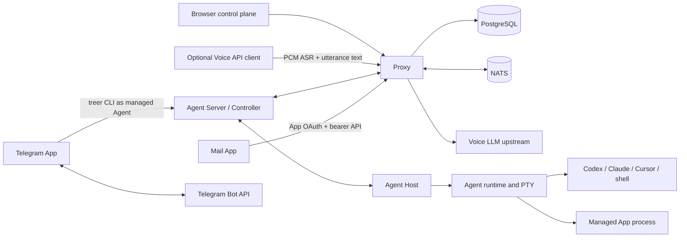

# Architecture

Treer separates durable coordination from machine-local process ownership.



## Ownership

| Component | Owns |
| --- | --- |
| `treer-proxy` | Public API, authentication, Policy, App identity, PostgreSQL metadata, Core Message, routing, ingress, distributed coordination, Voice ASR proxy, and Voice command LLM |
| `treer-agent-server` | Machine Controller, authenticated CLI parser/business logic, local API, Proxy link, explicit TCP bridge, and launch snapshots |
| `treer-agent-host` | Stable local child-process ownership and idempotent mutations |
| `treer-agent-runtime` | PTY lifecycle, bounded output replay, and working-directory containment |
| `treer-cli` | Thin argv/stdin/stdout/stderr/exit transport; terminal and local forwarding I/O |
| `treer-protocol` | Shared public and Controller wire models |
| `apps` | Ordinary service code, presentation, external APIs, configuration, secrets, and App-owned state |
| `launchers` | Optional profile-driven Agent runtimes and explicitly selected Agent Interfaces; not Host, Controller, or Core behavior |
| `deploy/updater` | Self-hosted Compose mutations over `docker.sock`; not part of Proxy |

The Host is intentionally product-agnostic. Shared wire models live in protocol
crates. Every distributed lookup is scoped by workspace before machine or Agent
ID.
`treer-protocol/src/lib.rs` retains constants and the public export surface;
private modules group inventory, Policy, identity, messages, Apps, workloads,
binary frames, network services, events, transport, and enrollment models.
Existing callers continue to import these types from the crate root.
Controller CLI composition remains in `cli_command.rs`; `cli_command/` owns
argument models and the App, Agent, message, profile, machine, service, and
Agent I/O command groups. The existing CLI transport contract is unchanged.

`treer-platform` contains machine-local transport, user paths, private-file
permissions and replacement, and Windows process ownership. Host framing stays
in `treer-host-protocol`: Unix sockets and Windows Named Pipes carry the same
requests and events. Windows pipe names include user-SID and machine-ID hashes;
only that user and SYSTEM can access them, and remote clients are rejected.
Windows defaults to a detached user Host. The Host owns a kill-on-close Job
Object, and runtime workloads get nested jobs; Controller replacement leaves
these handles with the stable Host. They manage lifecycle, not sandboxing.

Within `treer-proxy`, source modules follow the same boundaries: `api/` groups
HTTP and WebSocket handlers by use case, `auth/` groups durable account and
resource operations, and `state/` groups live connection, command, terminal,
network, and cluster behavior. The parent modules retain composition and shared
types; this is an in-process organization boundary, not a deployment boundary.
`api/network.rs` retains the existing handler exports. Its `network/` modules
separate service registration, runtime recovery, ingress authorization, HTTP
tunneling, Agent-facing operations, stream relay, discovery, metadata refresh,
and public TCP listeners; route wiring remains in `api.rs`.

The React app in `web/` is the browser control plane. Workspace views cover
terminals, launch profiles, managed Apps, network, machine overview, bounded
file upload, and audit.
`web/src/App.tsx` composes routes. Control-plane views and panels live in
`web/src/components/`; shared presentation helpers and preview fixtures live in
`web/src/lib/control-plane.ts`. Workspace state and its existing hooks stay
together in `components/workspace-app.tsx`.
`/admin` is the platform-administrator aggregate view: user, organization,
machine and Agent counts plus hourly traffic grouped only by traffic class.
`GET /api/admin/traffic` queries shared PostgreSQL metering across all workspaces;
it excludes Agent mirrors and instance-local unflushed counters, and returns
no tenant, user, machine, Agent or routing identifiers. Former inventory,
password-reset/session-revocation and platform activity routes are tombstoned
with a uniform authenticated 410 response. Platform invitations and image
updates retain their separate admin-cookie authorization. The sidebar
user menu opens a floating Settings overlay: Account edits preferred name and
email through `PATCH /api/auth/profile`; General stores Light/Dark appearance in
`localStorage` (`treer-theme`). Language is English or Simplified Chinese: the
stored choice (`treer-lang`, set in Settings → General or on the sign-in screen)
wins, otherwise the browser language (`zh*` selects Chinese). Server-provided
messages (API errors, Agent names) are shown as received. Embedded Agent
Interface iframes follow that setting through `theme` query, iframe
`color-scheme`, and a `treer:embed-theme` postMessage. The same URL and message
also carry `look` (`a|b|c`, read from optional `localStorage` `treer-look`;
omitted when unset) and `lang` (`en|zh`, the console language); only
whitelisted values are sent and the launcher UI validates them again. `look` is
applied live without being stored by the launcher; `lang` applies at load. Usage &
billing is a placeholder until a billing backend exists. Control-plane image
updates are not in Settings. They live on `/admin` for the platform
administrator.

## Core Message

Core stores immutable Message bodies, ordered context edges, recipient
snapshots, per-recipient delivery state, idempotency records, and a body-free
transactional outbox. `receive` repeats an unacknowledged delivery; `ack` is an
explicit idempotent mutation. A context edge never grants visibility to its
parent.

Managed Agents call the local `treer message` commands. The Controller verifies
the Agent workload credential and forwards the request under the machine
credential. The Proxy verifies both bindings, evaluates the workspace Policy,
and writes Core state.

Browser Apps call `/api/apps/{service_id}/messages...` with a standard
service-audience App token. The Proxy rechecks the registered service and human
membership, maps the claims to the same Policy subject and Message principal,
then uses the same Message implementation as the Agent routes.

`GET /api/apps/{service_id}/directory` includes capability
`app.directory-paths.v1`. Each visible Agent principal has its current canonical
Tree `path`, resolved from the authenticated workspace, not from token claims or
an App's name cache. Humans and unplaced legacy workloads return `path: null`.
The existing Agent discovery/metadata and human-list Policy filters still apply;
paths additionally require `agent.tree.read`, otherwise `path: null`. The
capability promises permission-filtered paths, not a path for every principal.
Names, folders and placements use a single read-only PostgreSQL REPEATABLE READ
snapshot, without taking the Tree mutation's exclusive workspace-row lock.
Clients requiring paths reject a missing capability as unsupported; same-name
Agents are identified by stable IDs and distinguished by their returned paths.

`TREER_ENABLE_CORE_MESSAGES` is a rollout switch, not an authorization or
isolation boundary.

### Bridge Agents

The `bridge` Agent kind is a command-owned integration point for providers that
are not running under Host control. Its command is started and supervised like
an ordinary `command` Agent, but `prompt` requests are placed in a bounded
Controller-local queue instead of being written to the process PTY. The bridge
process consumes its own queue through the authenticated local endpoint
`GET /api/agents/{agent_id}/prompt-queue` and can then invoke the normal
`treer` CLI commands in its own process. Queue reads consume up to 100 entries
at a time, each prompt is limited to 64 KiB, and the queue holds at most 256
entries; the queue is intentionally ephemeral and should be paired with Core
Message acknowledgement when delivery must survive a Controller restart.

Bridge Agent output is not exposed through `read` or `transcript`; those calls
return `agent_output_unavailable`. This keeps provider-owned transcripts out of
the Host terminal contract while preserving ordinary `prompt` authorization and
audit behavior. The queue endpoint accepts only the bridge Agent's own workload
credential and rejects attempts to read another Agent's queue.

## Organization invitation consent

The public auth configuration and invitation previews advertise
`organization.invitation-accept.v1`. Console must require that capability before
using this flow; an old Proxy's 404 is unsupported, never successful joining.
Upgrade every Proxy replica before activating the new Console flow: old replicas
do not enforce the new explicit-consent registration contract.

`POST /api/invitations/preview` accepts JSON `{ "token": "inv_…" }` and returns
flat `capabilities`, `status` (`valid` or `invalid`), `kind`, `organization_id`,
and `organization_name`. Unknown, used or deleted invitations return the same
invalid body with null metadata. Preview does not consume anything.
`POST /api/invitations/accept` accepts exactly one of `token` or `pending_id` and
returns `{organization_id, role, already_member}`. It requires a human session
cookie and the exact Console Origin; Authorization headers and cross-site
requests are rejected. A locked invitation row serializes membership insertion,
single-use consumption and audit in one PostgreSQL transaction. Organization
invites grant only `member`, including legacy invitations storing higher roles.
Existing members retain their role and do not consume an unused invite. Personal
invites return `not_organization_invite`; invalid invites return
`invalid_invitation`. Repeating acceptance by the consuming member is idempotent.

Registration consumes an organization invite and joins in the account-creation
transaction only with `join_organization:true`. Without that flag, invitation-only
deployments reject the registration as `invalid_invitation` without creating an
account or consuming the invite. Open-registration deployments may instead create
the personal account/organization and leave the org invite unused.
`POST /api/auth/oauth/{provider}/start` accepts JSON with `invite_token` and
`join_organization` (`true`/`false`), requires `X-Treer-Console: 1` and the exact
Console Origin, and returns `{authorization_url}`. Console validates HTTPS and
the selected IdP's exact origin before navigating; CSP remains unchanged.
GET start supports only the no-invite flow. PostgreSQL
stores an invitation hash, consent flag, state, browser-cookie hash and ten-minute
expiry; the state is consumed once only with the matching browser cookie. The
invitation never enters the IdP or callback URL. New OAuth accounts honor the
explicit join flag in the creation transaction; existing accounts never autojoin.
Pending handoff persistence after successful login is best-effort: failure logs
only a fixed warning/code, does not invalidate the login, and requires the user to
reopen their invitation link to join.

After OAuth, a still-valid invitation is retained as one opaque pending ID per
human session, with its invitation hash, user ID and ten-minute expiry. Console
returns to its root without an invitation token or pending ID in the URL.
`GET /api/invitations/pending` (cookie-only, no-store) returns the preview fields
plus `pending_id`, or 204 when absent, expired or unusable. Acceptance of that ID
is session/user-bound and consumes the pending entry once, even if subsequent
joining fails; it cannot be replayed by another session. Successful acceptance
clears pending state; `DELETE /api/invitations/pending` declines with 204 and the
same cookie/Origin checks. Replacement is audited; no audit contains raw tokens.
All replicas use shared PostgreSQL state, not process-local pending storage.

## App Identity

An enabled workspace service uses its stable `service_id` as OAuth client ID.
Redirect origins come from the service ingress registry. Human authorization is
Authorization Code with S256 PKCE. Codes are hashed, short-lived, and single
use. The resulting signed bearer token is audience-bound to the service.

Managed Agents can request a 60-second workload token for a registered service.
Apps may validate tokens through `/.treer/apps/identity/verify`; verification
also checks current service existence and, for humans, current membership.

Workspace ingress login uses an App-host browser verifier cookie and a SHA-256
challenge bound to a five-minute single-use code. Redemption is an atomic
PostgreSQL update and requires the verifier; each tab has an independent flow.
The host-prefixed HTTPS cookie is removed before forwarding to App code. A
separate bound-code table ensures old/new Proxy mixtures reject incompatible
login flows instead of accepting legacy unbound codes; ingress sessions remain
shared and compatible across Proxies.

Workspace ingress authenticates human ingress sessions and the Managed App UI
route authenticates platform human sessions. Both sign fresh 60-second human
`AppIdentityClaims` scoped to the resolved service and inject
`X-Treer-Identity-Token` after stripping untrusted Treer headers. Role comes from
current workspace membership. Embedded identity is carried internally as a
trusted request extension through virtual-host forwarding; it cannot come from
client headers. Anonymous public ingress and ordinary virtual-host/AIS tunnels
do not mint human identity. Agent ingress retains its existing service token.
Login/ingress credentials stay at the Proxy; App code receives only the short
service-scoped token. Apps verify this header first and fall back to App OAuth
only when it is absent. Human token forwarding uses the existing protocol and
verify endpoint, distinct from 12-hour OAuth grants; no new account type or
refresh protocol is introduced. The App owns Origin/Fetch Metadata defenses and
its data permissions. See the [App guidelines](../apps/GUIDELINES.md).


## Managed App Lifecycle

A Managed App is a durable Proxy record for one command, one machine, and one
HTTP UI port. Creation transactionally allocates a stable machine service and
virtual host. When wildcard ingress is configured, it also allocates a stable
origin and exposes it as `public_url`. The origin requires Workspace
authentication by default. An Agent may opt its Managed App into anonymous
access at creation time with `treer app create --public`; startup reconciliation
preserves that access mode and backfills private origins for existing Apps.
Start, stop, restart, delete, list, and show are available through the browser,
public API, Controller-local API, and `treer app` CLI. User-triggered lifecycle
changes append workspace audit events.

Controller Agent/App spawn paths resolve bare commands using only absolute
directories from the final workload PATH before sending an absolute executable
to the generic Host. Empty/relative PATH entries and relative command paths do
not trigger cwd search; lookup failures are explicit. Windows lookup uses fixed
`.exe`/`.com` extensions and drive-qualified search directories. Explicit absolute
commands are unchanged. Startup intent retains logical command/argv; first
start, restart and recovery share this resolution boundary. This is a Controller
behavior change, not a Host wire protocol change; older Controllers require an
upgrade before shared portable profiles are installed.

`POST /api/workspaces/{workspace_id}/apps/{app_id}/update` (and the authenticated
`/agent/workspaces/...` equivalent) patches `cwd`, `command`, and/or `args`.
Omitted fields remain unchanged; an empty args array clears arguments. The Proxy
requires `agent.startup.manage` and normal restart permissions (`agent.stop` on
the App runtime, `agent.create` on its machine), holds the shared workload
lifecycle advisory lock, and asks for side-effect-free `app.update.v1` preflight.
Only then does it persist the full launch specification and a monotonically
increasing startup revision before sending the replacement command. App/runtime
IDs, credentials, service/virtual host, public origin and desired state remain
unchanged. A stopped App stays stopped; a running App gets one replacement
generation under the Controller's recovery lock. Duplicate revisions do not
restart, conflicting or older revisions fail closed. Reconnect declarations and
startup validation reconcile the durable Proxy revision before recovery.

Failure after persistence leaves the new specification saved; it does not
silently roll back code or data. Use start/restart after repair, or explicitly
update back to the previous fields. Capability preflight rejects older
Controllers before writing the deployment; older Proxies have no update route.
The API accepts no environment or credential fields. Private App entry
configuration remains the place for secrets and mutable environment settings.

The human UI treats Managed Apps as Agent-owned deployments: it lists and
operates existing Apps but does not offer App creation. Selecting an App in the
workload tree embeds its human HTML root through the authenticated
`/api/workspaces/{workspace_id}/apps/{app_id}/ui/` browser tunnel, including on
mobile. This tunnel uses the App's owned virtual host and adjusts only embedding
headers to allow the configured control-plane origin and the Proxy's own origin;
all other App CSP directives remain enforced. Public origins and ordinary
virtual-host tunnels retain their original embedding headers.
Stopped Apps and offline machines show their
state instead. The workload menu's Logs action opens the runtime terminal, and
App views can switch between their interface and logs. Each App has a settings
view that changes only its owned ingress between `workspace` and `public`
access. General service, virtual-host, and ingress editing is not exposed in
the workspace UI.

Managed Agents may also register ordinary endpoints owned by their authenticated
Agent and machine. The Proxy derives ownership from credentials and applies
Policy; it does not trust caller-supplied Agent IDs. New custom virtual-host
writes are retired. HTTP origins are allocated from the stable service ID under
the operator's wildcard base domain; legacy aliases are read-compatible only.

Apps use the same `kind=app` Host process contract and lifecycle commands as
ordinary Agents. Each workload keeps its Agent ID and workload credential
across process replacements; `AgentInfo.run_generation` identifies the process
attempt. New Apps use that same ID for their durable App record. Existing Apps
retain their established runtime Agent ID. Service IDs and origins stay stable.

The Controller is the sole process recovery owner. The Proxy declares durable
App launch metadata through capability-gated `EnsureLifecycle`; the Controller
adopts a matching live Host process or saves its resolved launch. Start, stop,
restart, bootstrap, and recovery share a Controller lock, consult Host inventory,
and persist intent before spawning. A stopped workload remains in snapshots
even when a cold Host has no process for it. Explicit start and restart reuse
the saved launch and credential, and increment the persisted run generation
before launching a replacement. Stale Host events cannot overwrite a later run.
`StartupAdminGet`, `StartupAdminSet`, and `RestartWithStartup` require
`agent.startup-admin.v1`; older Controllers return `unsupported_command` without
receiving an unknown frame or losing their connection. Admin set replaces only
argv and optional cwd, retaining identity, credential, geometry, ports,
generation, and stopped intent. Atomic replace-and-restart holds the same
Controller recovery lock from durable replacement through Host stop and spawn.
Proxy startup mutations share the workload lifecycle guard with start/stop/delete.
App runtime edits are rejected: their durable launch comes from App deployment
metadata and must not be overridden by a local Agent startup edit.
Explicit App start/restart first sends `EnsureLifecycle(start_missing=false)`
to declare or adopt the workload without launching. This temporarily disables
local recovery, including for a surviving process, until the following explicit
start/restart command commits running intent. A lost acknowledgement leaves
recovery suspended; retrying the explicit action completes the handshake.

The Controller validates active identities with the Proxy before recovery.
Reconnect and heartbeat validation also apply centrally stopped intent to
surviving ordinary Agent and App processes before attempting recovery.
Enabled Apps retry missing processes on its five-second heartbeat, including
successful exits. Ordinary Agents recover after a Host epoch change or an
explicit restore; normal successful completion disables automatic recovery.
Explicit start remains available for stopped or completed workloads. The Proxy
projects App status from Agent events and does not run a second App supervisor.
Stop and deletion treat an already exited or missing Host process as stopped,
including responses from older Controllers. Deletion then revokes the identity
and removes Agent/App records; transport, authorization, and other stop failures
still block deletion because the process state has not been confirmed.
The CLI uses `treer agent start/stop/restart/read` for both kinds;
`treer app` lifecycle commands and `treer agent admin` remain compatibility paths.

Managed Apps do not install packages, inject secrets, migrate App-owned data,
or create a security boundary. Mail stores a local cookie-to-App-token mapping.
Telegram can still run inside a dedicated ordinary Agent and use that Agent's
normal CLI identity. Telegram users remain external metadata, not Treer human
principals.

## Policy

Workspace owners may select a private Managed App implementing
`treer.policy-provider/v1`. The Proxy validates its manifest and initial bundle,
then compiles action-indexed immutable structures and evaluates locally. Bundle
fetches use a capability-gated, bounded Controller command that can address only
the Managed App's machine-local loopback port. Revision invalidation is a typed
App-to-Controller-to-Proxy route with runtime binding checks. Details and failure
semantics are in the [Policy Provider protocol](policy-provider.md).

Provider bindings default to `publish_authority=owner_session`. A current owner
may explicitly select `provider_operator`, trusting the App's locally checked
management token for schema v2 edits. Core's dedicated operator validate/explain
routes verify the selected App's current runtime credential and read this choice
from Postgres per request. Core never receives the App management token. The
owner-only switch and audit commit together; a database trigger resets authority
when the App/service binding changes, including old Proxy writers. New clients
require `policy.publish-authority.v1` and never fall back from unavailable new
routes to unvalidated writes. Provider selection and owner recovery remain
owner-only. There are no grant/scope/expiry semantics; isolation is user-configured
Policy and OS/network isolation. The [publication contract](research/2026-10-13-policy-publish-authority.md)
describes compatibility and in-flight write limits.

Without a Provider, the legacy versioned JSONB Policy document remains the next
evaluator. Multi-recipient sends and multi-delivery acknowledgements evaluate
one pinned revision.

Policy covers Agent discovery/control, launch profiles, machine exec and file
write, machine/service/network mutation, workload identity, and Message
send/read/receive/ack/import. A
workspace without a Policy document currently defaults to allow; this is an
explicit product limitation.

Schema v2 adds bounded component path selectors and typed folder relations.
Subject/resource Tree facts come from one repeatable-read primary PostgreSQL
snapshot, never the Provider bundle or caller attributes. Tree mutations bump
`workspaces.tree_revision` in the same transaction; authorization verifies that
revision after evaluating a bundle and rejects `policy_tree_changed` if it
changed (the caller may retry). Moving/renaming changes rule applicability
without reloading the bundle. Tree facts are **not cached** in this version:
multiple Proxies read the same committed DB truth, so lost NATS or PostgreSQL
notification hints cannot retain old paths. PostgreSQL notifications prepare
future invalidation; adding a Tree cache would require a separate consistency
design. The acceptance check is not an atomic fence for subsequent network or
Host effects; already accepted operations are not revoked by a later move.

Owner Tree read/manage and Provider recovery remain static authenticated Core
routes, outside delegated rules. Non-owner human Tree requests are evaluated
by Policy. Owner-only explain resolves existing workspace IDs/paths and may
simulate a validated candidate without installing it. Monitor would-deny
diagnostics are bounded, body-free, per-Proxy in-memory records plus structured
logs, not a durable global audit. The configured Provider diagnostics bridge
requires its fresh runtime credential **and** a service-audience current human
owner token; neither identity alone grants diagnostic access. Schema/capability
incompatibility fails explicitly, including in fail-open mode. See the
[v2 contract](research/2026-10-13-policy-schema-v2-contract.md) and
[path-rule design](research/2026-10-13-policy-path-rules-design.md).

## Routing And State

Machines connect outward to the Proxy over an authenticated WebSocket. The
Controller keeps up to 16 machine exec commands pending independently of socket
receive/heartbeat processing. An exec child can make a nested Treer request on
the same connection without waiting for its own exit. Duplicate pending command
IDs share the original execution; completed results retain the usual cache.
Excess exec commands fail with `machine_exec_busy`. Connection teardown drops
pending exec futures and their kill-on-drop children; other commands retain
their existing ordering and lifecycle locks.

The Controller-to-Host protocol is a local length-prefixed bincode socket. The
Host keeps each frame-read future alive across asynchronous output/process
events; the Controller uses a dedicated reader task. Neither direction may
discard partial framing state. Frames remain bounded by `MAX_HOST_FRAME_BYTES`;
invalid lengths, decoding or request protocol versions close the connection
without interpreting residual bytes as another request.
The socket filename is a 16-hex FNV-1a hash of the machine id (`h-<hash>.sock`)
so the full path stays inside `sockaddr_un` limits on macOS, where the default
runtime directory under `$TMPDIR` is already long. Browser terminal and service
streams route through the Proxy. Registered service connections are multiplexed
onto the destination Controller link, including cross-Proxy NATS routing. There
is no source-side transparent interception. Explicit per-workload HTTP proxy
entries can relay ordinary internet HTTP/HTTPS directly from the source machine.

Machine exec and file upload reuse the authenticated Proxy-to-Controller
command path. Exec is a non-interactive argv vector with a 30-second ceiling
and bounded stdout/stderr. Upload accepts at most 16 MiB from the browser,
crosses distributed Proxy routing in 192 KiB chunks, stages a temporary file in
the requested directory, and renames it into place only after every chunk
arrives. Directories are canonicalized beneath the enrolled Host root and file
names cannot contain path separators. These operations run in the Controller,
so a Controller hot update enables them without replacing the stable Host.

Single-file CLI transfer is a separate `machine.file-transfer.v1` capability;
it does not change the legacy browser upload protocol. `machine put/get` use
bounded 64 KiB chunks with one acknowledged chunk in flight. The Proxy holds no
file or transfer registry: it authenticates and evaluates `machine.file.write`
or `machine.file.read` on every call, and sends the derived caller/workspace and
requested filesystem path to the target Controller. Handles bind that identity,
direction, path and connection generation. Disconnect invalidates handles;
queued blocking tasks from older generations cannot recreate them. Proxy reconnect never
replays pending file-transfer commands into a new Controller connection.
The default per-file size is 64 MiB, configurable by
`TREER_MACHINE_FILE_MAX_BYTES` up to 1 GiB; active
handles are capped at eight per machine and two per caller, with 30-second idle
and 15-minute total deadlines. Retrying starts a new transfer, never implicitly
overwrites or resumes a possibly committed operation.

Paths are relative to the enrolled Host root. Handle traversal rejects symlinks,
reparse points, mount crossings, special files and hard-link aliases; Treer
private state and transfer temporary names are reserved. Same-directory private
staging stays 0600 until the verified publication step. Writes use atomic
no-replace unless explicit overwrite is requested. A private, bounded recovery
journal and process lease clean recorded abandoned staging on next use after a
Controller crash. Both ends compare SHA-256; downloads to stdout first spool to
a private local file and emit bytes only after verification. A digest verifies
the streamed bytes, not a filesystem snapshot. Direct OS access by the same
account, including renaming open ancestors on Unix, remains outside isolation.

Policy resource attributes `file.path`, `file.direction`, and upload
`file.mode`/`file.overwrite`/known `file.size` are request facts, not Tree paths or
resolved filesystem aliases. Existing Tree path selectors do not implement a
filesystem containment policy. Durable body-free read/write intent precedes
reads and publication; completion records contain only path, size, SHA-256 and
caller/machine identity. SQL audit and filesystem commit are separate, so a
failed completion audit leaves an intent, not a promise of complete auditing.

Controller registration carries a legacy protocol value, an additive list of
supported protocol versions, and explicit command capabilities. The Proxy
selects the highest common version and rejects capability-gated commands before
they reach an older Controller. A Controller ignores unknown top-level Proxy
messages and returns a correlated `unsupported_command` result for an unknown
command action; either case keeps the machine connection alive during rolling
upgrades. New command variants must declare a capability unless they are part
of the protocol-v4 baseline.

Automatic mode starts the Host as a detached `nohup` process in its own process
group on Linux and macOS, so reaping the caller's process group does not stop
the Host. Treer records the PID and process start identity and redirects output to
its state directory so lifecycle commands can reject reused PIDs and manage the
correct Host. Both Agent and App workloads save a resolved launch snapshot before process creation,
including stable Agent ID, argv, cwd, dimensions, credential, and desired state.
Restore validates identity and durable stopped intent with the Proxy, synchronizes
Host inventory, attaches surviving processes, and launches missing ones at most
once per Host epoch. Manual restore can retry a failed start. The Controller
alone owns recovery; enabled Apps retry exited processes on its five-second
heartbeat. The Proxy supplies legacy launch declarations on reconnect and
retains service metadata, without running a second process supervisor.
Stop disables recovery in Proxy
state before forwarding to the Controller; deletion/revocation prevents replay.
A normal successful Agent exit disables its snapshot. Abnormal termination is
recoverable after a new Host epoch or explicit restore, not an unbounded restart loop.

The Controller also owns one private state directory per Agent,
`<state dir>/agent-private/<server_id>/<agent_id>`, derived only from its own
server ID and the stable Agent ID (both `[A-Za-z0-9_-]{1,128}`; anything else
fails the launch with `agent_private_state_invalid_identity`). Every process
start, restart and recovery prepares the three Treer levels with mode 0700 (a
protected current-user DACL on Windows), re-verifies them and the canonical
ancestors, and injects `TREER_AGENT_PRIVATE_STATE_DIR`. The variable is omitted
with a fixed log code when a level is unsafe (`agent_private_state_unsafe`), the
directory cannot be prepared (`agent_private_state_unavailable`), or it would
be inside the workload cwd on a non-hidden path (`agent_private_state_inside_cwd`)
or inside a version-controlled tree
(`agent_private_state_inside_vcs_worktree`: a `.git`/`.hg`/`.jj`/`.svn`/
`.bzr`/`.sl` marker of any file type at the private directory or any of its
ancestors up to the filesystem root, regardless of the cwd, inspected without
following links and failing closed). A hidden, repository-free state path under
the cwd (cwd = HOME with `~/.local/state/treer`) is allowed; a cwd equal to the
private directory is refused; the verdict is recomputed on every
start, restart and report, and refusals carry a fixed hint without paths. The
agent-private root also holds `.gitignore` and `.ignore` (`*`, 0600, never
rewritten). The Agent still starts and launchers keep private-state features
disabled; launchers mirror the same predicate. The inherited
environment filter removes the variable, so only this explicit injection can
supply it. Stop, restart, Controller replacement and startup updates never
touch the directory.

Deletion cleanup is confirmed by the Proxy tombstone only. Startup validation
(`startup/validate`, on connect and every heartbeat) asks about startup entries
plus every private directory under this server, and the Proxy answers
`deleted_agent_ids` from `deleted_agents`. Under the recovery lock the
Controller stops a still-running deleted Agent and defers, otherwise removes the
directory (`remove_dir_all`, no symlink following, lstat before and after) and
the stale startup entry. The directory itself is the pending record; an older
Proxy omits the field and nothing is purged. Directories under other server IDs
are never touched.

The local API exposes the caller's own private state to the workload identity
only: `GET /api/private-state` (status, usage, feature
`agent.private-state.v1`), `POST /api/private-state/reservations {bytes}`,
`POST /api/private-state/reservations/{id}/commit` and
`DELETE /api/private-state/reservations/{id}`. Admission uses the Controller's
own measurement of the whole Agent directory (symlinks counted, never
followed; walks over 65536 entries count as over quota): 256 MiB per Agent,
4 GiB per machine, 64 MiB per reservation, 16 open reservations per Agent, 15
minute reservation TTL, and a 1 GiB free-space floor. Commit re-measures and
rejects over-cap content; unknown, expired and foreign reservations share
`private_state_reservation_expired`. Reservations are memory only; a restarted
Controller recounts from disk. `agent.private-state.v1` is a launcher-contract
feature, not an AIS manifest capability.

The workspace workload tree stores folders and placements in PostgreSQL.
Agents and Apps share the same tree and lifecycle endpoints. Folder mutations
serialize against the workspace row, validate parents and cycles, and require
current workspace membership for browser callers. Controller-forwarded Agent
and operator calls use the machine/workload authentication path and distinct
`agent.tree.read` / `agent.tree.manage` actions on the workspace's `agent.tree`
resource. Placement IDs must belong to active credentials
in that workspace. Deleting a folder promotes its children to its parent (or
the workspace root); placement order is preserved. Organizing the tree does
not change filesystem paths, machine ownership, process identity, or Policy.
The Controller parses `treer agent mkdir/ls/mv/rmdir` and resolves tree paths.
CLI Agent creation, profile launch and `treer app create` resolve explicit
`--folder` paths before creation. Omission is left to the Proxy: under the
workspace Tree transaction lock it reads the authenticated Agent/App caller's
current placement and inherits its direct folder; human/operator callers default
to root. Creation wire `folder_id: "/"` selects root explicitly, while a normal
folder ID selects that folder. Missing caller placement returns `caller_unplaced`
rather than silently selecting root. Environment/cwd and self-reported paths
are not authority. Explicit destinations retain `agent.tree.manage` checks.
New Agent/App identities, names and placements are reserved in the same
transaction before process dispatch; sibling uniqueness and inheritance are
shared by all Proxies through PostgreSQL. App identity reservation stores only
an undisclosed random credential hash; activation uses the existing missing-local-
credential rotation path. Existing nodes are not backfilled or relocated.
Placement does not change the process `cwd`.

Agent creation failures carry optional `error.details` with a bounded bare
`command`, the selected `machine_id`, reserved `agent_id` and `creation_state`.

Production Proxy command dispatch checks PostgreSQL `deleted_agents` before
sending Create/ensure commands, including cluster-owner forwarding and pending
replay after a replacement Controller's initial snapshot. Database failure
rejects dispatch; no cached projection substitutes for this check. A pending
command rejected during replay is completed with an error and removed. This is
defence in depth: deletion can race a send-time read, so reservation cleanup must
first persist the Controller's denied-ID fence before committing revocation.
Only a Controller `command_not_found` proof for that same Agent, issued before
startup persistence or Host dispatch and returned directly to that creation
command, permits Proxy compensation (an event-stream field is not proof): credential
revocation and removal of the reserved name make the placement inactive and the
name reusable (`identity_removed`). Revoked credential/placement tombstones may
remain for reconciliation. Timeout, disconnect, legacy errors without this
proof, or mismatched identity keep the reservation (`reserved_outcome_unknown`);
failed compensation reports `cleanup_failed`. Clients must not automatically
repeat creation in either case. The Proxy replaces raw spawn diagnostics with
fixed text and records the failed creation without PATH, argv or output. A
missing provider inside an already running launcher is a separate launcher
status, not inferred from terminal output. This error contract installs nothing.

Provider CLI installation (#123 part 2) is a human-session feature under
`/api/workspaces/{ws}/machines/{machine}/provider-clis` (`GET recipes`,
`POST prepare`, `POST install`, `POST check`, `GET operations/{id}`), gated by
current workspace membership, Policy `machine.exec` on the machine and the
`machine.provider-cli-install.v1` capability that both the Proxy health document
and a Controller advertise (old peers fail with 501). `prepare` and `install`
additionally require `machine.provider-cli-install.v2` (#134): a Controller
that installs without first observing the prefix is refused with 409
`provider_cli_controller_outdated`, never served by the unobserved flow. The recipe table is
release data (`launchers/agent/provider-recipes.json`, schema
`treer.provider-recipes/v1`) embedded by `treer-protocol` and validated at
Controller start: typed `npm-global` installs with exact version, SHA-512
`integrity`, allowlisted registry, `ignore_scripts` or an inline lifecycle
review, `check` restricted to the recipe's `binary_names` and `--version`;
any violation withholds the capability. The Controller owns one expansion
function that produces the plan shown at `recipes`/`prepare` and executed on
`install`: `npm pack` into a private job directory, SHA-512 verification of the
single tarball, `npm install --global <local tarball>`, `npm prefix --global`,
then the probe from that prefix's `bin` (never PATH). Before minting a token,
`prepare` is admitted against the per-minute attempt and live-token ceilings
(`provider_cli_prepare_attempts`, counted before any Controller command and
whatever the outcome), then runs the Controller's observation (`ProviderCliObservation`, the
same procedure as `check`): `npm prefix --global` under the private job
environment, an `lstat` of `<prefix>/bin/<binary>` and, only when a regular
file inside the prefix is there, the recipe's version probe. The state is
decided from evidence (`absent`, `installed` with a strict normalized semver,
or `unknown` with a named reason), never from an error, and maps to exactly
one action: `install`, `replace` (with a `version_relation` of `upgrade`,
`downgrade`, `incomparable` or `unknown`) or `noop` (already at the pinned
version: no token, no operation, no machine slot). The Proxy validates the
observation's shape and consistency before using it (a malformed one is a
502 Controller error). An unresolvable prefix is
409 `provider_cli_state_unobservable`. The Proxy binds the hash of the
displayed plan, the `observation_hash`
(`treer.provider-cli-observation/v1` over recipe hash, target version, state,
current version, executable and presence), the action and the relation into
the 120-second single-use confirmation token (hashed at rest, bound to
workspace, machine, user, session, recipe triple, table hash and Controller
build); `install` refuses a busy machine or an old/offline Controller before
consuming the token, requires `acknowledged_relation` equal to the bound
relation for `downgrade`, `incomparable` and `unknown` (400 otherwise, token
left usable), then consumes it and inserts the single active operation per
machine (PostgreSQL partial unique index) in one transaction before
dispatching exactly once with the consent. The Controller re-observes before
any step and again immediately before the install step under the operation's
deadline (unconfirmed cleanup ends the operation `unknown`, a spent budget
ends it timed out, nothing spawns past the deadline) and fails the operation
as `provider_cli_state_changed` (reporting the path-free `observed_before`
summary) on any other difference, including the action having become `noop`.
Truncated probe output never yields a version, and an observation whose probe
left a process behind is refused at `prepare` (409
`provider_cli_probe_unconfirmed`). Provider CLI commands are never
replayed to a replacement Controller; a lost dispatch, a silent Controller past
a ten-minute grace or a missing Controller record ends as `unknown`, which only
the machine's own later report may resolve. Output lives only in the
Controller's private store (24 hours, 64 results, refusal when full); the Proxy
keeps scope, status, recipe hashes, argv hash, action, relation, observation
hash and the observed state/version, and audit rows carry no token, output or
path (the observed executable path reaches only the creator's `prepare` and
`check` responses). See [security](security.md#provider-cli-installation).

New human Agent creations also atomically record their original human creator,
workspace and machine in `agent_creation_reservations`; legacy and non-human
creations are not backfilled. Only that human's current workspace session can
call `POST /api/workspaces/{workspace}/agent-reservations/{agent}/cleanup` with
an empty body (or `{}`). The route explicitly evaluates `agent.delete` for the
stable Agent/machine even without a live snapshot. Foreign/missing reservations
share a 404; Policy denial is 403. Runtime snapshot or durable App metadata
rejects cleanup (409). Under the lifecycle guard, the capability-gated Controller
command verifies runtime, startup and all Host inventory absence, then durably
fences the ID before acknowledging. Old Controllers return 501; unavailable or
unconfirmed fencing leaves the reservation intact (503/409). PostgreSQL then
atomically revokes credentials, releases names/services, adds the tombstone and
records `agent.reservation.cleanup` with human/Agent/machine metadata only.
Repeated cleanup of one's own deleted reservation is idempotent. UI confirmation
is explicit and never automatically retries creation. App identities and service
audience human tokens cannot use this human-session API. The startup-store
[rollback floor](../scripts/machine-rollout.md#startup-store-rollback-floor)
applies after a fence is persisted, including when subsequent PG cleanup fails.
After a successful Create acknowledgement or validated inventory/event, the
reservation is marked confirmed and no longer eligible (404), including after
that workload stops. Confirmation ignores deleted IDs so late inventory cannot
invalidate an already-cleaned reservation's idempotent response. These small
ownership/confirmation records are bounded by credential rows and cascade with
them. Mixed-version limitation: reservations made by an older Proxy have no
ownership record and cannot use this route, even for `cleanup_failed`; an
operator must inspect the machine and reconcile through supported lifecycle or
administrative procedures. Do not treat a missing record as permission to retry
creation. If fencing succeeded but PG cleanup failed, explicitly retry cleanup
to finish bookkeeping; never delete the local fence or retry Agent creation.

`workload.create-placement.v1` is advertised by Proxy health and Controllers.
The thin CLI gates creation/profile launch before forwarding argv. Controller
creation routes check Proxy health and use new `/agents/placed`, `/apps/placed`
and `/launch-profiles/{id}/launch-placed` forwarding endpoints, so an old Proxy
cannot silently ignore destination fields, even during a mixed-Proxy rollout.
Proxy creation performs a side-effect-free `creation_placement_check` command
before reserving identity; older Controllers return a capability error without
disconnecting. Legacy client payloads remain accepted by upgraded endpoints
with the new omission/inheritance default.
The thin CLI remains argv/I/O transport. New or renamed folders reject `/`,
`.` and `..` names and duplicate sibling names under the workspace lock.
Legacy ambiguous names remain addressable by folder ID. CLI `rmdir` sends
`require_empty=true`, checked atomically; browser deletion retains child
promotion. Agent control routes mirror the browser workload-tree routes under
`/agent/workspaces/{workspace_id}/workload-tree`; the local API exposes
`/api/workload-tree` with the same folder and placement suffixes.
The browser refreshes visible trees every five seconds and on window focus,
preserving open editors and ignoring background reads superseded by a mutation.
Within each folder, workloads follow their persisted position; entries without
a placement follow in natural name order, with Agent ID breaking ties. Folders
sort by name. Dragging a workload onto the upper or lower half of another row
inserts it before or after that row, including moves between folders. The Move
up / Move down menu actions provide the same persisted ordering on mobile and
for keyboard users. Refreshing the page or replacing machine inventory does not
reset a saved order.

`treer-agent-server restore --workspace ID` starts a saved machine installation
without re-enrollment, then reconciles it. `treer runtime restore --all` handles
an already-running local Controller; an operator may select `--server ID`.
Reports distinguish started, attached, stopped, revoked, failed, and waiting
endpoints. Recovery recreates processes, not in-memory conversations or open TCP
sessions. Saved local state and executables must still exist.

Startup specs do not provide start-at-boot or Host crash restart. A per-user
systemd service or LaunchAgent remains an explicit operator choice, and attached
foreground mode remains available for diagnostics. An
Apple container machine is a Linux guest: install it with `treer --skill
macos-container` and do not reuse a Mac `server_id` inside the guest. The
persisted service-manager choice and fallback reason keep later lifecycle
commands and machine diagnostics consistent. The Controller publishes that
state as an optional machine snapshot field so older Controllers remain valid
during rolling upgrades. TUI reads the same persisted state locally.
Startup is complete only when the Controller identity endpoint reports
`proxy_connected`. Local `/api/agents` success is not a Proxy lease. Because
service configuration is saved before native registration, `service repair` can
reconstruct a partial installation without another enrollment key. A
registration refresh probes the Host after registration: an unavailable socket
starts the Host directly, while a live Host receives a Controller-only restart
to preserve its agents and PTYs. Restart request failures are captured during
recovery and included in the final diagnostic if recovery fails. A live
foreground Host is never replaced as a fallback by another foreground process.
Manager changes remove the old native registration or stop the old `nohup` process
first, and reject transitions that would leave a running Host owned by the
wrong supervisor. `connect` reuses the
existing `server_id` for an already-installed hostname and workspace; a second
Controller for that `server_id` fails if the listen socket is already live.
Re-enrollment sends the installed `server_id` with the persistent installation
identity, and the Proxy validates and rotates the credential in the enrollment
transaction. Recovery therefore does not depend on the previous machine
credential and does not consume the one-use key before identity conflicts have
been checked.
Service commands without `--workspace` list local installs or, when exactly one
exists, use it. They no longer imply the workspace name `default`.

Proxy replicas fence machine connections through a distributed ownership
lease. The newest authenticated connection owns the `server_id` and the previous
socket is closed with `duplicate_machine_connection`. Duplicate and
`stale_connection` are retryable: the loser stays in the reconnect loop with
capped exponential backoff until it is owner again, the credential is revoked,
or the server is deleted. An absent/expired distributed lease is not a duplicate:
the locally current authenticated connection may recreate it using atomic
create-if-absent. Renewal uses revision checks and retries ownership races;
it never overwrites a different connection's live lease. Backplane errors are
reported separately from a confirmed competing owner. Registration still lets
a new authenticated connection take over immediately, and old socket cleanup
cannot release its replacement's lease. The Proxy sends WebSocket pings at most every 20
seconds and closes a silent socket within 60 seconds so a sleeping Mac is not
advertised Online. On Unix `SIGCONT` (lid open / thaw), the Controller aborts a
socket whose last activity is older than that dead interval and reconnects.

## Explicit service transport and CLI

The Controller opens only the endpoint named by an authenticated Proxy service
request. TCP Data, WindowUpdate, HalfClose, and Reset preserve binary data,
backpressure, and independent EOF. Disconnect cancels streams; transport epochs
reject stale queued frames. Datagram, Direct, and source Open frames are retired.
OS DNS is unchanged. A registered host
must be reachable from the Controller; external containers supply their own
port mapping or reachable address.

Private service connections use a standard authenticated WebSocket between the
Controller and Proxy so public HTTP gateways can carry them. Binary messages
carry stream bytes; the shared `SERVICE_STREAM_EOF` text frame preserves each
direction's EOF. The local CLI-to-Controller `treer-tcp` upgrade stays local;
the Proxy also accepts that older upgrade on direct HTTP deployments. Both
transports share connection limits and ongoing identity, service, and Policy
revocation checks.
Forwarded connections retain the authenticated source machine and Agent in the
Controller request; traffic accounting keeps both machine directions distinct.
Human/browser connections continue to use the client traffic bucket.

Each newly launched managed Agent or App runtime gets its own loopback HTTP
proxy listener, owned by the Controller. Its port fixes the source Agent ID;
callers cannot select an identity with request headers. Standard `http_proxy`,
`https_proxy` (and uppercase equivalents), `no_proxy`, and `TREER_HTTP_PROXY`
are injected into the process and inherited by its children. Loopback bypasses
the proxy by default. This is explicit client cooperation, not network capture.

`http://SERVICE_ID.treer/path` or `http://NAME.treer/path` is a proxy-only address
for a registered service. Names are workspace-scoped and case-insensitive; use
1-63 ASCII letters/digits with optional internal hyphens for a name address.
Other display names remain accessible by ID. Names are resolved on each new
request/CONNECT, without a name cache. HTTP uses the canonical token audience
as its connect target, so a concurrent rename cannot separate identity from
the destination. CONNECT resolves names before applying Policy to the stable ID.
The proxy obtains a fresh service-audience identity token for each HTTP request,
then opens the existing authenticated service stream. It injects
`X-Treer-Identity-Token` and, if the caller supplied no application Authorization,
`Authorization: Bearer ...`. Existing application Authorization is preserved.
Calls from the entry and thin CLI to the local API bypass environment proxies;
the workload credential travels only to the local API, never to the destination service.
No new public API, custom host, or OS DNS record is needed.

Agent HTTP communication uses the same service registry and proxy path.
`treer service register --primary --protocol http` marks one Agent-owned service
as its primary endpoint. PostgreSQL enforces one primary per workspace/Agent
and requires HTTP with an Agent binding; older records default to non-primary.
The Controller's `treer agent address NAME_OR_ID` resolves the Agent under the
caller's identity and selects only its explicitly marked primary, returning
`http://SERVICE_ID.treer/`. Re-registration from that Agent updates the existing
service through the normal ownership/Policy checks, preserving its stable ID.
Agent launchers own HTTP server startup and re-registration after cold recovery.
API routes and schemas are owned by the serving Agent; callers use curl or any
HTTP client through their inherited proxy. AIS registration remains separate:
its private listener must also be registered as a service for this address path.
HTTP does not introduce durable delivery or offline queues.

Other HTTP destinations connect directly without Treer token injection.
CONNECT supports ordinary HTTPS and native TCP protocols, including SSH; a
`SERVICE_ID.treer` or `NAME.treer` CONNECT target uses the registered endpoint
regardless of the authority's port. Treer authenticates the stream, but cannot insert HTTP
headers inside TLS or replace SSH authentication. WebSocket upgrades and
streaming bodies pass through. A public App's HTTPS URL remains ordinary opaque
CONNECT traffic; use its service ID address for automatic HTTP identity.

Host process metadata stores the listener port alongside the workload identity.
Controller replacement rebinds that same port for surviving processes; a bind
conflict fails explicitly. Cold recovery launches with a freshly allocated
entry and new inherited environment. Stop/exit removes the listener and cancels
its connections. A running process created by an older Controller has no proxy
metadata/environment and must be relaunched to opt in. User-owned isolated or
externally supervised workloads must arrange proxy reachability/configuration
themselves; loopback in a separate network namespace denotes a different host.

The thin CLI sends raw argv and streams to authenticated `/api/cli/session`.
The Controller runs its parser in a bounded child invocation with caller-specific
credentials. Help and embedded skills therefore follow the Controller version.
Interactive terminal and service-forward requests return typed transport
instructions; the client handles terminal bytes/resize or a local loopback
listener without understanding product command syntax. Version mismatches fail
explicitly. Do not pass client filesystem paths for remote interpretation: pipe
input through stdin. Command retries must use the operation's own idempotency
contract; the CLI does not automatically replay mutations after disconnect.

Private service connections authenticate at open and are periodically checked
against current identity, membership, service, and Policy. HTTP ingress defaults
to workspace access. Anonymous raw TCP requires configured Proxy ports and an
explicit public publish action. Deleting a service or disabling its TCP mapping
terminates active TCP forwarding. Raw TCP is not HTTP and receives no injected
identity headers or application authentication.

Browser terminal attach is revisioned. The Host keeps a bounded PTY output ring
keyed by stream epoch. Reconnects send the client's last cursor; the Host
returns only later chunks and a gap flag when the ring has slid past that
cursor. Live Controller lag resyncs from the same Host read instead of dropping
bytes. The Proxy owning the browser session learns the stream epoch from the
delivered Ready frame, including when the Controller is connected to another
Proxy, so live output carries the same reconnect cursor across replicas.
When a process exits, the Host releases its child and PTY resources
immediately and retains only the latest 256 completed process records for
Controller restart recovery. This is opaque byte replay, not Agent-protocol
item storage.

## Agent Interface Server

### Queued prompts and completion notifications

AIS prompt delivery uses `POST /v1/prompts`. `delivery: "queue"` is the default:
send immediately when idle, otherwise append to FIFO without steering the active
turn. Only explicit `delivery: "steer"` may insert into the active turn. Controller
builds `sender` from authenticated caller identity attested by the Proxy; public
prompt bodies cannot supply it. Human/operator submissions have `sender: null`.

```json
{"operation_id":"cmd_123","mode":"prompt","text":"Review the patch",
 "delivery":"queue",
 "sender":{"agent_id":"ag_sender","path":"/team/reviewer","name":"reviewer"},
 "notify":{"on":["done","failed","interrupted"],"to":"ag_sender"}}
```

The launcher persists the submission before replying HTTP 202:

```json
{"submission":{"id":"sub_123","disposition":"queued","position":1}}
```

Disposition is `queued`, `sent`, or `steered`; positions are one-based pending
FIFO positions, or null for immediately dispatched work. Repeated operation IDs
return the same receipt without a duplicate task (conflicting reuse is rejected).
`prompt.queue` advertises durable delivery and submission correlation;
`prompt.notify` advertises durable terminal notifications; `prompt.queue.read`
advertises queue inspection, submission lookup, and cancellation. Controller
checks verified manifest capabilities before dispatch. Missing support returns
`queue_unsupported`, including queued delivery to PTY-only Agents; it must never
silently fall back to terminal insertion. Explicit steer retains the terminal
compatibility path, but a terminal cannot provide correlated wait or notification.

`GET /v1/queue` returns `{"submissions":[...]}` for pending items.
`GET /v1/submissions/{id}` returns `{"submission":{...}}`, including completed
items, so `--wait` observes its own submission rather than a generic idle state.
`DELETE /v1/queue/{id}` cancels only a pending item, returning the same submission
envelope with state `interrupted` and an explanatory error. Running items return
a conflict; abort remains a separate operation. Controller authorizes queue
reads with `agent.queue.read`; the authenticated sender may inspect/cancel its own
submission, while other cancellation requires `agent.queue.cancel`. These are
Controller-to-AIS requests carrying the existing verified instance headers.

Submission fields are `id`, `sender`, RFC3339 `created_at`, nullable `position`,
`text_preview` (at most 1024 UTF-8 bytes), `state` (`queued`, `running`, `done`,
`failed`, `interrupted`), nullable `turn_id`, `assistant_preview` (at most 4096
UTF-8 bytes), and nullable `error`. `/v1/status` includes `busy` and
`queue_length` (pending count, excluding the active turn). Queue, receipt,
terminal result and notification outbox survive launcher/Agent restart. Pending
work resumes in order; uncertain in-flight work is marked interrupted rather
than submitted twice unless the harness can prove exact turn resumption.

Optional `notify.on` selects terminal outcomes. `notify.to` is a Core Message
recipient ID and defaults to the authenticated sender's Agent ID; an operator
without an Agent identity must supply a recipient explicitly. A launcher uses
its own Treer identity to send one idempotent Core Message with submission ID,
turn ID, outcome and bounded assistant preview. Its recipient comes from the
saved submission, never a completion event. A durable notification outbox retries
failures under a stable idempotency key (`prompt-submission/<id>/terminal`), so
completion does not require sender polling. Core Message Policy and workspace
membership still apply; notification delivery failure does not rerun a task.

Shared Rust wire models live in `treer-protocol::prompt_delivery` (re-exported
at crate root). This contract is implemented by launcher owners; Core does not
persist launcher-owned harness sessions or task queues.

Controller command capability `agent.prompt-delivery.v1` gates the distinct
`submit_prompt`, `queue_read`, `submission_read`, `queue_cancel`, and
`interface_status` wire variants. Old Controllers reject them before dispatch;
the legacy `prompt` variant remains explicitly steering for older senders.
The public prompt request accepts only `text`, `delivery`, `notify`, and
`require_receipt`; unknown fields (including `sender`) are rejected. The Proxy
resolves sender ID/name/canonical tree path from the authenticated Policy
subject and Controller forwards that attestation over its private AIS link.
Both queued and steering requests require explicit `notify` (`--notify` in the
CLI) for completion messages. Omitted or null `notify` stays absent through
Proxy and Controller, including interrupted outcomes; sender attestation does
not imply a notification subscription. An explicit empty `notify.on` selects
no outcomes. `require_receipt` preflights correlated wait support before any
task is sent; `--wait` only polls its submission and does not enable messages.

An Agent may register one versioned Agent Interface Server (AIS) with its local
Controller. AIS is a semantic adapter beside the Agent's native application
server; it does not replace Host process ownership. Registration is authenticated
with the Agent workload credential, scoped to that same Agent, verified against
`GET /v1/manifest`, and cached in the Controller's local runtime directory.
Agents register once at start; repeating register rewrites `registered_at` and
remounts any embedded UI. A hot Controller restart restores a descriptor only
when its Agent ID, PID, and process start time still match, then revalidates the
live manifest before the first Proxy snapshot. The cache contains no credentials and is not a trust
boundary. The descriptor and capabilities travel with `AgentInfo` snapshots
and events, while the live endpoint remains on machine loopback (shared in an unisolated environment). An
optional `ui_path` exposes an embedded browser interface on that same endpoint;
HTTP and WebSocket traffic below the path is opaque to the semantic AIS contract.

### Browser-defense forwarding provenance

Core uses three protected headers for the registered interface endpoint:

| Header | Agent UI tunnel | Controller semantic AIS request |
| --- | --- | --- |
| `X-Treer-Interface-Source` | `proxy-ui` | `controller-api` |
| `X-Treer-Agent-Id` | Resolved target Agent ID | Target Agent ID |
| `X-Treer-Interface-Instance` | Registered descriptor instance ID | Registered descriptor instance ID |
| `Host` | `127.0.0.1:<registered-port>` | `agent-interface` |

The authenticated Agent UI route validates browser Origin through the existing
BrowserAccess check, removes cookies/platform authorization and every client
`x-treer-*` header, then injects its own target-bound provenance. Origin is
preserved as browser context, not used as the provenance token. HTTP and WebSocket
upgrades share this preparation. Ordinary virtual-host, App UI and public ingress
tunnels remove these headers and never inject interface provenance. The Controller
only transports the UI tunnel's opaque TCP bytes; the Proxy prepares its HTTP
headers. Controller-generated semantic AIS HTTP requests inject `controller-api`
and have no browser Origin. None of these headers contains a workload credential.

The launcher checks source plus target and current instance, independently checks
Host against its loopback listener authority (localhost/127.0.0.1/[::1] with the
actual listener port; `agent-interface` only for Controller calls), and rejects
unmarked browser requests: Origin or any Sec-Fetch-* header identifies a browser
request, including simple POST, navigation/file GET, and WebSocket upgrades.
Untrusted preflights receive no permissive CORS response. An arbitrary Host is
rejected even if the request has no Origin, closing the DNS-rebinding file path.
Only `controller-api` without browser Origin may attest a queue submission's
sender; `proxy-ui` must not turn user-supplied sender JSON into Controller identity.

These public marker values defend against ordinary browser-origin access, not
malicious local non-browser clients: same-account clients can forge them and
remain trusted. They are not cryptographic authentication or a per-request Policy
decision for arbitrary launcher APIs. The opaque UI tunnel grants access to the
interface as a whole; applications must not claim it enforces each semantic Core
action on arbitrary UI routes. A future stronger local boundary needs a distinct
rotating interface capability plus external OS isolation. Never trust arbitrary
X-Forwarded-* or client-provided markers as proof of an authenticated human.

Strict launchers need updated Core provenance producers. Old Controller semantic
calls lack the marker and must fail clearly rather than accepting browser-like
requests as a compatibility fallback; update Proxy/Controller before enabling
strict launcher guards. No Controller protocol version change is required for
these HTTP headers, and old launchers simply ignore the additional header.

The Controller routes `prompt.submit` and `transcript.read` through AIS when the
matching capability is present. Explicit steering and legacy prompt commands
can use the PTY compatibility path when no prompt interface is available.
Default queued submission requires `prompt.queue`; missing support returns
`queue_unsupported` rather than silently inserting text into the terminal.
Once an AIS request is dispatched, errors are returned
without a second PTY submission. Every prompt carries the Proxy command ID as
an idempotency key. An interface with `state.observe` owns working, idle, and
blocked state; Host exit state remains authoritative. Terminal attach, raw
input, resize, stop, and delete remain Host/PTY operations.

The optional [Agent launcher](../launchers/agent/README.md) lives in
`launchers/agent` and uses the same public launch-profile and Agent Interface
contracts as an external recipe. It owns one shared AIS implementation and
browser UI, serving semantic routes and presentation from one private listener
registered with `ui_path: "/"`. Each Treer Agent binds to one harness
thread/session; the UI has no thread list or session switcher. Provider choices,
session persistence, and presentation remain launcher concerns, without adding
provider routes, Agent kinds, or Host-wide UI state to Core.

Release Controllers distribute a same-commit portable launcher payload via local
`treer-agent-server launcher install|update|status|rollback`. Core verifies and
extracts embedded manifest bytes into private staging, then calls the launcher's
shared installer transaction with structured stdin. The launcher owns profile
save/readback/rollback and version activation; Core does not duplicate those
transactions or start Agents. Authenticated `GET /api/interface/contract`, also
exposed as `treer interface contract`, reports the actual Controller's AIS and
feature sets, minimum launcher security epoch, and enrolled machine/root context.
Missing fields are unknown, not compatible. Immutable versions and a private
atomic current pointer separate asset installation from explicit Agent restart.
See the [installation design](research/2026-10-13-launcher-subcommand-design.md).

Harness-specific behavior lives in `launchers/agent/src/harness/{codex,claude,acp}`.
Codex uses its native `codex app-server`; Claude Code uses its native stream-JSON
interface. Cursor, Grok Build, OpenCode, and Gemini use the shared ACP adapter
with provider-specific commands from the launch profiles. The Cursor profile
uses `cursor-agent`, avoiding Grok Build's `agent` executable alias. Built-in
`--kind codex` and `--kind claude` remain ordinary TUI/PTY paths without AIS.

The standalone Rust ACP launcher, Pi UI, DSH AIS, provider-specific AIS Apps,
and `apps/ais-kit` have been retired in favor of this single launcher. Provider
authentication belongs to each provider's own CLI/configuration; the launcher
does not automatically reuse Codex credentials for other providers. This
consolidation adds no authentication, Policy, or isolation boundary: launcher
code runs with the Agent's operating-system authority, and the Controller
remains the external authorization and routing boundary.

`GET /v1/transcript` pages by conversation turn. A turn starts at a user prompt
and includes the following entries until the next user prompt. Leading non-user
session entries attach to the first turn; a log with no user prompt is a single
page. `page` (or `cursor`) is the 0-based turn index. `limit` is the number of
turns and defaults to 1. The response includes `page`, `page_count`,
`next_page`, and string `cursor` / `next_cursor` aliases.

Creating an Agent with a `recipe` git URL lets the operator pick an already
installed interactive CLI on that machine. Treer reuses an idle Agent of that
kind when one exists; otherwise it starts that CLI and prompts it with the bundled
[install skill](../skills/treer-install/SKILL.md). The installer clones that
repository, creates a different command Agent, and upserts a workspace launch
profile from `treer-agent.json`. Each created Agent is one thread. Extra
conversations use Launch to create another Agent. A recipe start script may
attach to an already healthy same-type listener instead of starting another
app-server and frontend. It still runs a per-Agent AIS adapter with a unique
instance ID and immutable thread binding, so prompt, transcript, state, events,
and abort cannot drift into another Agent's conversation. Launch does not run
Install recipe again. Readiness is the Agent's verified AIS descriptor,
including `ui_path` for browser recipes, and the saved profile; a raw health
probe does not establish semantic capabilities. This is not an App package
installer.

Covered organization, workspace, and membership mutations write their audit
event in the same PostgreSQL transaction. Successful Agent create, rename, stop,
and delete operations, App lifecycle operations, machine exec and file upload,
and machine rename and delete operations append runtime
audit events after the Controller result; an audit write failure is logged
without turning a completed runtime mutation into a retryable API failure.

Workspace audit reads use `GET /api/workspaces/{workspace_id}/audit-events`
and capability `workspace.audit.v1` in `/api/auth/config`. They query the same
`organization_audit_events` table, with an exact workspace and organization join;
organization-wide NULL-workspace events never enter this feed. The existing
organization audit endpoint and its projection are unchanged. Previously stored
events with a workspace ID are readable; unattributed history is not backfilled
or guessed. New writes also retain an immutable `workspace_origin_id` without a
workspace foreign key. Hard deletion clears the live FK but the organization
view can still attribute these new events to the original workspace. Older
already-unattributed rows remain unknown; organization deletion still cascades.

The shared response is `{events, next_cursor, maintenance}`. Older responses may
omit `maintenance`. `before` is a positive, exclusive
sequence cursor within the requested workspace; events sort by descending
sequence. `limit` defaults to 50 and clamps to 1..100. `next_cursor` is the last
returned sequence only when another matching row exists, otherwise NULL. Optional
`since` (inclusive) and `until` (exclusive) are RFC3339 instants; when both are
present they must be ordered and at most 366 days apart. `actor_id`, `action`, and
`resource_kind` are exact matches (1..128 ASCII letters, digits, dot, underscore
or hyphen). Unknown parameters are rejected. Responses, including authentication
and query errors, use `Cache-Control: no-store`.

`workspace.audit.read`, on resource kind `workspace` and its stable ID, has an
owner-role baseline. Organization owners/admins and direct/group workspace owners
qualify; the current model has no separate workspace-admin role. Enforced deny
can restrict an owner. Other workspace members and authenticated machine/Agent
subjects need a **matched allow rule in enforce mode**; neither monitor mode nor
an action-default allow grants this sensitive read. Machine/Agent requests use
`/agent/workspaces/{workspace_id}/audit-events` and their existing authenticated
workspace binding. `/api/apps/{service_id}/audit-events` accepts service-audience
identity tokens and evaluates the represented human/Agent, not the App's own
authority. Its verified audience fixes the workspace. It is not an App-runtime
credential shortcut. User membership is rechecked from the database on each read.

The workspace projection drops stored display names, correlation IDs and unknown
payload fields. Known lifecycle/startup events may expose only machine ID and
numeric startup revision; machine exec may expose numeric exit/timeout metadata
and booleans. File paths, hashes, content, argv, environment and configuration
payloads are excluded. Audit reads do not append events to their own feed. This
is a partial activity record; bodies must never be added to fill coverage gaps.

State-change audit delivery is explicit:

| Mutation | Audit commit boundary |
| --- | --- |
| Folder create/update/delete, placement create/update/delete, workload rename | Same Tree SQL transaction; failed audit rolls back mutation. Folder removal includes child promotion in one event. |
| Enrollment claim/re-enrollment | Same credential binding and single-use enrollment consumption transaction. Replayed keys fail without a success event. |
| Service create/update/delete, virtual-host create/delete, HTTP ingress create/update/delete, TCP publish/unpublish | Best-effort after durable mutation; audit failure logs a body-free warning and does not turn a committed change into a retryable failure. |
| Managed App compound creation/deletion | Service, virtual-host creation and placement events share the App transaction. Service deletion represents cascading routing removal rather than separate child events. |
| Accepted prompt submission | Best-effort durable outbox admission after Controller success; only captured actor, target ID, timestamp and event ID. A repeated accepted submission request can produce another acceptance event; this is not a turn-completion log. |

No-op updates and repeated ingress publication do not append state-change events.
Authenticated request middleware scopes actor kind/ID to the request future,
never caller-provided JSON. Internal work without that scope (including spawned
recovery tasks) is attributed to `system`, not to an inherited user. Enrollment
uses the trusted enrollment creator. New events have empty payloads and omit
resource names, paths, hosts, ports, argv, environment, tokens and bodies. The
organization view retains its existing human actor display-name lookup; the
workspace projection removes it. Existing runtime
lifecycle audit events may additionally describe the operation's outcome.
Core Message delivery and all failure paths do not have universal audit coverage;
there is no universal transactional outbox or completeness guarantee for best-effort writes.
`system` also covers authenticated entry points that do not set the request
scope (for example administrator or service-audience handlers); it is not proof
that a human or App was uninvolved.

Prompt admission waits for one durable PostgreSQL function call, bounded to one
second; it is not a memory queue or a promise of zero database latency. A shared
settings-row lock bounds pending entries to 4096 across replicas. Overflow is
durably counted in `audit_maintenance_settings.overflow_total` and logged without
row values. Unconfirmed admission (including ambiguous commit acknowledgements)
has a separate process-local counter in warning logs. Successful runtime commands
are not retried or failed because auditing failed. One worker per Proxy drains
up to 256 entries each second; audit insertion, event-ID deduplication and outbox
deletion commit together. Actor attribution never depends on the worker's task
local state. After HTTP graceful shutdown drains requests, the worker has ten
seconds to flush; remaining committed entries replay after restart. The settings
row is a global serialization point: contention can exhaust the one-second
admission budget. Capacity has no tenant fairness quota; one workspace can fill
it and cause counted prompt-audit drops for others. This does not drop prompts
or transactional security-kind audit writes.

Every organization audit kind has the same maximum age, initially 180 days.
`--audit-retention-days` / `TREER_AUDIT_RETENTION_DAYS` (30..3650) explicitly changes
the shared database setting; omission preserves it. Workers use database time
and bounded 256-row cleanup batches. Idle checks run every minute; each cleanup
cycle starts additional batches within a one-second/64-batch budget, then resumes
next second if backlogged. A started batch may finish beyond that budget (with a
five-second database statement timeout), so slow first batches can make progress.
Retention configuration is
read from PostgreSQL, not a NATS cache. Deletion records monotonic scoped
`maintenance.deleted_through` watermarks; these do not establish completeness.
Increasing retention cannot recover deleted history, and cleanup may lag the
configured deadline. Organization deletion still cascades immediately.

Proxies advertise `audit.maintenance.v1`. Authorized organization and workspace
audit reads expose retention metadata; `include_statistics=true` additionally
returns recent 30-day UTC rows/day/action, independent of pagination filters,
with `statistics_since` and an explicit `statistics_truncated` flag at 4096
groups. Workspace statistics never include organization-only/other-workspace
events or the global overflow count. With statistics, scoped `oldest_expired_at`
indicates a retention backlog. Statistical scans have a two-second statement
budget, but no result cache or per-user rate limit. No new read privilege is introduced.
The additive schema supports older Proxies writing directly; old-only rollback
pauses draining and cleanup until an updated worker returns. Operators must use
consistent explicit retention settings across replicas (the last explicit
configuration wins). Configuration changes produce a platform audit row and
typed old/new/source startup log; no keep-forever setting or export is provided.
Operators must budget stored audit,
outbox, indexes, WAL and backups separately.
Legacy/local-auth enrollments without a durable workspace retain their existing
behavior and have no organization audit attribution; no organization is invented.

Hold-to-talk audio stays on the Proxy only long enough to forward 16 kHz PCM16
to the configured ASR vendor. After a transcript is available, `POST
/api/workspaces/{workspace_id}/voice/command` sends that text to an OpenAI
Responses or Chat Completions upstream. The model receives
[the voice skill](../skills/treer-voice/SKILL.md) and a compact roster, then
calls a `treer` tool. The Proxy executes allowed CLI-equivalent commands
(`status`, `whoami`, `machine list`, `agent ls|show|prompt|read`) in-process
as the signed-in user and returns a speakable reply. Clients own recording,
speech gating and presentation; the repository no longer ships native iOS/Android
clients. Vendor ASR and LLM keys stay in Proxy environment variables. See
[Voice configuration](operator-guide.md#voice-apis-opt-in). This is not the later
confirm-card Voice Live protocol, and clients do not run the Treer CLI for it.

Workspace access is either `organization` or `restricted`. The former admits
every current organization member; the latter admits only direct user grants,
group grants, workspace creators, and organization managers. Direct and group
grants carry `owner` or `member`, with owner taking precedence. Organization
`owner`/`admin` roles imply workspace ownership, and workspace creation adds an
explicit owner grant for the creator.
Removing an organization member also clears that user's direct workspace and
group grants.

Workspace deletion is workspace-owner-only and requires every
Machine in the workspace to be deleted first. Deletion is lazy: PostgreSQL
marks the workspace with a deletion tombstone and revokes remaining Agent
credentials, while retaining its messages, traffic history, policies, and
other records. Active workspace queries and authentication exclude tombstoned
rows. The Proxy then evicts the affected credential, service-ingress, and
virtual-host caches, removes the workspace from in-memory active state, and
broadcasts a `WorkspaceDeleted` cluster projection so other Proxies stop
serving it.

PostgreSQL is the durable source for accounts, organizations, workspaces,
machine credentials, services, ingresses, App OAuth codes, policy, audit,
the logical traffic-usage ledger, and Core Message. Usage is metered once after
payload delivery and classified by route and meter version; NATS framing,
control messages, fan-out, and retries are operational transport costs rather
than customer usage. The legacy machine-traffic table remains read-compatible
during retention while new counters write to `traffic_usage_hourly`. NATS
supplies events and cross-Proxy live routing but is not Message or billing
truth. App SQLite databases contain only App-owned sessions or external
delivery mappings.

## Self-hosted control plane updates

Compose pulls immutable GHCR tags for Proxy, App, and the updater sidecar.
`/admin` exposes Check and Apply to the platform administrator. Proxy forwards
those calls to the sidecar over HTTP with a shared token and never mounts
`docker.sock`. Hosted Railway leaves `TREER_UPDATER_URL` unset.

After the control plane moves, enrolled machines still run
`treer-agent-server update` on each host. Remote machine rollout from the
control plane is a follow-up.

See [Self-hosted Compose](../deploy/README.md), [Security](security.md) for
trust claims, and [Quality](quality.md) for the verification matrix.

### App email transport

The Proxy exposes `POST /api/apps/{service_id}/email` as a narrow transport for
Managed Apps, reusing `CloudflareEmailSender`. Protocol request/response types
live in `treer-protocol::SendAppEmailRequest` / `SendAppEmailResponse`. Ownership,
service-audience identity, `email.send`, organization verified email/allowlist,
and durable hourly reservations are checked before provider dispatch. Sender
configuration and Cloudflare credentials never cross the Proxy/App boundary.
PostgreSQL `app_email_sends` stores fingerprint/idempotency/state, and
`app_email_attempts` is body-free delivery audit and rate history. Email is not
Core Message and does not create or wake an Agent.

The [email-endpoint App](../apps/email-endpoint/README.md) owns its SQLite
thread-to-message/email mapping, retry queue, local outbox, membership/email
bindings, HTML page, and optional wake. Core owns canonical message bodies and
per-recipient delivery. Agent requests and human replies use their own verified
service tokens through App Message routes. App-owned channel data does not add
email fields to Core Message or use an App credential to impersonate a caller.

### Workspace tree target identity

Agent/App display names are unique per containing Tree folder. One shared pure
resolver interprets absolute/relative paths and sibling-only bare names for CLI
and Message recipients. Operators resolve from root; Agent callers resolve from
their containing folder. ID-addressed transport and Policy remain unchanged.
`agent_not_in_folder` carries bounded matching paths in `hint`; there is no
implicit global name fallback. Discovery paths are derived from current Tree
placements; Message paths, like names, are immutable send-time display snapshots.

Proxy serializes name reservation, placement, rename, and move under the
workspace Tree lock. Creation reserves placement before process dispatch,
allowing distinct folders to create identical labels without a temporary root
collision. Owned service/virtual-host names retain workspace-wide uniqueness.
Controller capability `agent.path-targets.v1` gates new CLI semantics, with a
pre-dispatch upgrade error against old Controllers. [Design decisions and tests](research/2026-10-12-agent-path-targets.md).
