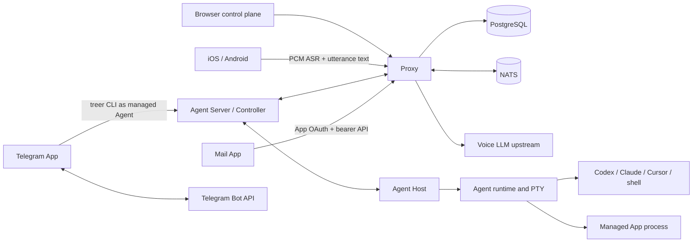

# Architecture

Treer separates durable coordination from machine-local process ownership.

## Ownership

| Component | Owns |
| --- | --- |
| `treer-proxy` | Public API, authentication, Policy, App identity, PostgreSQL metadata, Core Message, routing, ingress, distributed coordination, Voice ASR proxy, and Voice command LLM |
| `treer-agent-server` | Machine Controller, authenticated CLI parser/business logic, local API, Proxy link, explicit TCP bridge, and launch snapshots |
| `treer-agent-host` | Stable local child-process ownership and idempotent mutations |
| `treer-agent-runtime` | PTY lifecycle, bounded output replay, and working-directory containment |
| `treer-cli` | Thin argv/stdin/stdout/stderr/exit transport; terminal and local forwarding I/O |
| `treer-protocol` | Shared public and Controller wire models |
| `apps` | Ordinary service code, presentation, external APIs, configuration, secrets, and App-owned state |
| `launchers` | Optional profile-driven Agent runtimes and explicitly selected Agent Interfaces; not Host, Controller, or Core behavior |
| `deploy/updater` | Self-hosted Compose mutations over `docker.sock`; not part of Proxy |

The Host is intentionally product-agnostic. Shared wire models live in protocol
crates. Every distributed lookup is scoped by workspace before machine or Agent
ID.
`treer-protocol/src/lib.rs` retains constants and the public export surface;
private modules group inventory, Policy, identity, messages, Apps, workloads,
binary frames, network services, events, transport, and enrollment models.
Existing callers continue to import these types from the crate root.
Controller CLI composition remains in `cli_command.rs`; `cli_command/` owns
argument models and the App, Agent, message, profile, machine, service, and
Agent I/O command groups. The existing CLI transport contract is unchanged.

`treer-platform` contains machine-local transport, user paths, private-file
permissions and replacement, and Windows process ownership. Host framing stays
in `treer-host-protocol`: Unix sockets and Windows Named Pipes carry the same
requests and events. Windows pipe names include user-SID and machine-ID hashes;
only that user and SYSTEM can access them, and remote clients are rejected.
Windows defaults to a detached user Host. The Host owns a kill-on-close Job
Object, and runtime workloads get nested jobs; Controller replacement leaves
these handles with the stable Host. They manage lifecycle, not sandboxing.

Within `treer-proxy`, source modules follow the same boundaries: `api/` groups
HTTP and WebSocket handlers by use case, `auth/` groups durable account and
resource operations, and `state/` groups live connection, command, terminal,
network, and cluster behavior. The parent modules retain composition and shared
types; this is an in-process organization boundary, not a deployment boundary.
`api/network.rs` retains the existing handler exports. Its `network/` modules
separate service registration, runtime recovery, ingress authorization, HTTP
tunneling, Agent-facing operations, stream relay, discovery, metadata refresh,
and public TCP listeners; route wiring remains in `api.rs`.

The React app in `web/` is the browser control plane. Workspace views cover
terminals, launch profiles, managed Apps, network, machine overview, bounded
file upload, and audit.
`web/src/App.tsx` composes routes. Control-plane views and panels live in
`web/src/components/`; shared presentation helpers and preview fixtures live in
`web/src/lib/control-plane.ts`. Workspace state and its existing hooks stay
together in `components/workspace-app.tsx`.
`/admin` is the platform-administrator inventory: user, machine, and Agent
counts expand into lists, password-reset links, and live Agents per machine. The sidebar
user menu opens a floating Settings overlay: Account edits preferred name and
email through `PATCH /api/auth/profile`; General stores Light/Dark appearance in
`localStorage` (`treer-theme`) and currently offers English only. Embedded Agent
Interface iframes follow that setting through `theme` query, iframe
`color-scheme`, and a `treer:embed-theme` postMessage. Usage &
billing is a placeholder until a billing backend exists. Control-plane image
updates are not in Settings. They live on `/admin` for the platform
administrator.

## Core Message

Core stores immutable Message bodies, ordered context edges, recipient
snapshots, per-recipient delivery state, idempotency records, and a body-free
transactional outbox. `receive` repeats an unacknowledged delivery; `ack` is an
explicit idempotent mutation. A context edge never grants visibility to its
parent.

Managed Agents call the local `treer message` commands. The Controller verifies
the Agent workload credential and forwards the request under the machine
credential. The Proxy verifies both bindings, evaluates the workspace Policy,
and writes Core state.

Browser Apps call `/api/apps/{service_id}/messages...` with a standard
service-audience App token. The Proxy rechecks the registered service and human
membership, maps the claims to the same Policy subject and Message principal,
then uses the same Message implementation as the Agent routes.

`TREER_ENABLE_CORE_MESSAGES` is a rollout switch, not an authorization or
isolation boundary.

### Bridge Agents

The `bridge` Agent kind is a command-owned integration point for providers that
are not running under Host control. Its command is started and supervised like
an ordinary `command` Agent, but `prompt` requests are placed in a bounded
Controller-local queue instead of being written to the process PTY. The bridge
process consumes its own queue through the authenticated local endpoint
`GET /api/agents/{agent_id}/prompt-queue` and can then invoke the normal
`treer` CLI commands in its own process. Queue reads consume up to 100 entries
at a time, each prompt is limited to 64 KiB, and the queue holds at most 256
entries; the queue is intentionally ephemeral and should be paired with Core
Message acknowledgement when delivery must survive a Controller restart.

Bridge Agent output is not exposed through `read` or `transcript`; those calls
return `agent_output_unavailable`. This keeps provider-owned transcripts out of
the Host terminal contract while preserving ordinary `prompt` authorization and
audit behavior. The queue endpoint accepts only the bridge Agent's own workload
credential and rejects attempts to read another Agent's queue.

## App Identity

An enabled workspace service uses its stable `service_id` as OAuth client ID.
Redirect origins come from the service ingress registry. Human authorization is
Authorization Code with S256 PKCE. Codes are hashed, short-lived, and single
use. The resulting signed bearer token is audience-bound to the service.

Managed Agents can request a 60-second workload token for a registered service.
Apps may validate tokens through `/.treer/apps/identity/verify`; verification
also checks current service existence and, for humans, current membership.

Workspace ingress authenticates human ingress sessions and the Managed App UI
route authenticates platform human sessions. Both sign fresh 60-second human
`AppIdentityClaims` scoped to the resolved service and inject
`X-Treer-Identity-Token` after stripping untrusted Treer headers. Role comes from
current workspace membership. Embedded identity is carried internally as a
trusted request extension through virtual-host forwarding; it cannot come from
client headers. Anonymous public ingress and ordinary virtual-host/AIS tunnels
do not mint human identity. Agent ingress retains its existing service token.
Login/ingress credentials stay at the Proxy; App code receives only the short
service-scoped token. Apps verify this header first and fall back to App OAuth
only when it is absent. Human token forwarding uses the existing protocol and
verify endpoint, distinct from 12-hour OAuth grants; no new account type or
refresh protocol is introduced. The App owns Origin/Fetch Metadata defenses and
its data permissions. See the [App guidelines](../apps/GUIDELINES.md).

## Managed App Lifecycle

A Managed App is a durable Proxy record for one command, one machine, and one
HTTP UI port. Creation transactionally allocates a stable machine service and
virtual host. When wildcard ingress is configured, it also allocates a stable
origin and exposes it as `public_url`. The origin requires Workspace
authentication by default. An Agent may opt its Managed App into anonymous
access at creation time with `treer app create --public`; startup reconciliation
preserves that access mode and backfills private origins for existing Apps.
Start, stop, restart, delete, list, and show are available through the browser,
public API, Controller-local API, and `treer app` CLI. User-triggered lifecycle
changes append workspace audit events.

The human UI treats Managed Apps as Agent-owned deployments: it lists and
operates existing Apps but does not offer App creation. Selecting an App in the
workload tree embeds its human HTML root through the authenticated
`/api/workspaces/{workspace_id}/apps/{app_id}/ui/` browser tunnel, including on
mobile. This tunnel uses the App's owned virtual host and adjusts only embedding
headers to allow the configured control-plane origin and the Proxy's own origin;
all other App CSP directives remain enforced. Public origins and ordinary
virtual-host tunnels retain their original embedding headers.
Stopped Apps and offline machines show their
state instead. The workload menu's Logs action opens the runtime terminal, and
App views can switch between their interface and logs. Each App has a settings
view that changes only its owned ingress between `workspace` and `public`
access. General service, virtual-host, and ingress editing is not exposed in
the workspace UI.

Managed Agents may also register ordinary endpoints owned by their authenticated
Agent and machine. The Proxy derives ownership from credentials and applies
Policy; it does not trust caller-supplied Agent IDs. New custom virtual-host
writes are retired. HTTP origins are allocated from the stable service ID under
the operator's wildcard base domain; legacy aliases are read-compatible only.

Apps use the same `kind=app` Host process contract and lifecycle commands as
ordinary Agents. Each workload keeps its Agent ID and workload credential
across process replacements; `AgentInfo.run_generation` identifies the process
attempt. New Apps use that same ID for their durable App record. Existing Apps
retain their established runtime Agent ID. Service IDs and origins stay stable.

The Controller is the sole process recovery owner. The Proxy declares durable
App launch metadata through capability-gated `EnsureLifecycle`; the Controller
adopts a matching live Host process or saves its resolved launch. Start, stop,
restart, bootstrap, and recovery share a Controller lock, consult Host inventory,
and persist intent before spawning. A stopped workload remains in snapshots
even when a cold Host has no process for it. Explicit start and restart reuse
the saved launch and credential, and increment the persisted run generation
before launching a replacement. Stale Host events cannot overwrite a later run.
`StartupAdminGet`, `StartupAdminSet`, and `RestartWithStartup` require
`agent.startup-admin.v1`; older Controllers return `unsupported_command` without
receiving an unknown frame or losing their connection. Admin set replaces only
argv and optional cwd, retaining identity, credential, geometry, ports,
generation, and stopped intent. Atomic replace-and-restart holds the same
Controller recovery lock from durable replacement through Host stop and spawn.
Proxy startup mutations share the workload lifecycle guard with start/stop/delete.
App runtime edits are rejected: their durable launch comes from App deployment
metadata and must not be overridden by a local Agent startup edit.
Explicit App start/restart first sends `EnsureLifecycle(start_missing=false)`
to declare or adopt the workload without launching. This temporarily disables
local recovery, including for a surviving process, until the following explicit
start/restart command commits running intent. A lost acknowledgement leaves
recovery suspended; retrying the explicit action completes the handshake.

The Controller validates active identities with the Proxy before recovery.
Reconnect and heartbeat validation also apply centrally stopped intent to
surviving ordinary Agent and App processes before attempting recovery.
Enabled Apps retry missing processes on its five-second heartbeat, including
successful exits. Ordinary Agents recover after a Host epoch change or an
explicit restore; normal successful completion disables automatic recovery.
Explicit start remains available for stopped or completed workloads. The Proxy
projects App status from Agent events and does not run a second App supervisor.
Stop and deletion treat an already exited or missing Host process as stopped,
including responses from older Controllers. Deletion then revokes the identity
and removes Agent/App records; transport, authorization, and other stop failures
still block deletion because the process state has not been confirmed.
The CLI uses `treer agent start/stop/restart/read` for both kinds;
`treer app` lifecycle commands and `treer agent admin` remain compatibility paths.

Managed Apps do not install packages, inject secrets, migrate App-owned data,
or create a security boundary. Mail stores a local cookie-to-App-token mapping.
Telegram can still run inside a dedicated ordinary Agent and use that Agent's
normal CLI identity. Telegram users remain external metadata, not Treer human
principals.

## Policy

Workspace owners may select a private Managed App implementing
`treer.policy-provider/v1`. The Proxy validates its manifest and initial bundle,
then compiles action-indexed immutable structures and evaluates locally. Bundle
fetches use a capability-gated, bounded Controller command that can address only
the Managed App's machine-local loopback port. Revision invalidation is a typed
App-to-Controller-to-Proxy route with runtime binding checks. Details and failure
semantics are in the [Policy Provider protocol](policy-provider.md).

Without a Provider, the legacy versioned JSONB Policy document remains the next
evaluator. Multi-recipient sends and multi-delivery acknowledgements evaluate
one pinned revision.

Policy covers Agent discovery/control, launch profiles, machine exec and file
write, machine/service/network mutation, workload identity, and Message
send/read/receive/ack/import. A
workspace without a Policy document currently defaults to allow; this is an
explicit product limitation.

## Routing And State

Machines connect outward to the Proxy over an authenticated WebSocket. The
Controller-to-Host protocol is a local length-prefixed bincode socket. The
socket filename is a 16-hex FNV-1a hash of the machine id (`h-<hash>.sock`)
so the full path stays inside `sockaddr_un` limits on macOS, where the default
runtime directory under `$TMPDIR` is already long. Browser terminal and service
streams route through the Proxy. Registered service connections are multiplexed
onto the destination Controller link, including cross-Proxy NATS routing. There
is no source-side transparent interception. Explicit per-workload HTTP proxy
entries can relay ordinary internet HTTP/HTTPS directly from the source machine.

Machine exec and file upload reuse the authenticated Proxy-to-Controller
command path. Exec is a non-interactive argv vector with a 30-second ceiling
and bounded stdout/stderr. Upload accepts at most 16 MiB from the browser,
crosses distributed Proxy routing in 192 KiB chunks, stages a temporary file in
the requested directory, and renames it into place only after every chunk
arrives. Directories are canonicalized beneath the enrolled Host root and file
names cannot contain path separators. These operations run in the Controller,
so a Controller hot update enables them without replacing the stable Host.

Controller registration carries a legacy protocol value, an additive list of
supported protocol versions, and explicit command capabilities. The Proxy
selects the highest common version and rejects capability-gated commands before
they reach an older Controller. A Controller ignores unknown top-level Proxy
messages and returns a correlated `unsupported_command` result for an unknown
command action; either case keeps the machine connection alive during rolling
upgrades. New command variants must declare a capability unless they are part
of the protocol-v4 baseline.

Automatic mode starts the Host as a detached `nohup` process in its own process
group on Linux and macOS, so reaping the caller's process group does not stop
the Host. Treer records the PID and process start identity and redirects output to
its state directory so lifecycle commands can reject reused PIDs and manage the
correct Host. Both Agent and App workloads save a resolved launch snapshot before process creation,
including stable Agent ID, argv, cwd, dimensions, credential, and desired state.
Restore validates identity and durable stopped intent with the Proxy, synchronizes
Host inventory, attaches surviving processes, and launches missing ones at most
once per Host epoch. Manual restore can retry a failed start. The Controller
alone owns recovery; enabled Apps retry exited processes on its five-second
heartbeat. The Proxy supplies legacy launch declarations on reconnect and
retains service metadata, without running a second process supervisor.
Stop disables recovery in Proxy
state before forwarding to the Controller; deletion/revocation prevents replay.
A normal successful Agent exit disables its snapshot. Abnormal termination is
recoverable after a new Host epoch or explicit restore, not an unbounded restart loop.

The workspace workload tree stores folders and placements in PostgreSQL.
Agents and Apps share the same tree and lifecycle endpoints. Folder mutations
serialize against the workspace row, validate parents and cycles, and require
current workspace membership for browser callers. Controller-forwarded Agent
and operator calls use the machine/workload authentication path and distinct
`agent.tree.read` / `agent.tree.manage` actions on the workspace's `agent.tree`
resource. Placement IDs must belong to active credentials
in that workspace. Deleting a folder promotes its children to its parent (or
the workspace root); placement order is preserved. Organizing the tree does
not change filesystem paths, machine ownership, process identity, or Policy.
The Controller parses `treer agent mkdir/ls/mv/rmdir` and resolves tree paths.
CLI Agent creation and profile launch resolve `--folder` before creation,
defaulting to the calling Agent's placement (operators default to root), then
place the returned Agent through the same Policy-checked Tree API. A failed
post-create placement reports the created ID for a move retry rather than
creating a second workload. This does not change the process `cwd` or the
Proxy/Controller create and launch wire contracts.
The thin CLI remains argv/I/O transport. New or renamed folders reject `/`,
`.` and `..` names and duplicate sibling names under the workspace lock.
Legacy ambiguous names remain addressable by folder ID. CLI `rmdir` sends
`require_empty=true`, checked atomically; browser deletion retains child
promotion. Agent control routes mirror the browser workload-tree routes under
`/agent/workspaces/{workspace_id}/workload-tree`; the local API exposes
`/api/workload-tree` with the same folder and placement suffixes.
The browser refreshes visible trees every five seconds and on window focus,
preserving open editors and ignoring background reads superseded by a mutation.
Within each folder, workloads follow their persisted position; entries without
a placement follow in natural name order, with Agent ID breaking ties. Folders
sort by name. Dragging a workload onto the upper or lower half of another row
inserts it before or after that row, including moves between folders. The Move
up / Move down menu actions provide the same persisted ordering on mobile and
for keyboard users. Refreshing the page or replacing machine inventory does not
reset a saved order.

`treer-agent-server restore --workspace ID` starts a saved machine installation
without re-enrollment, then reconciles it. `treer runtime restore --all` handles
an already-running local Controller; an operator may select `--server ID`.
Reports distinguish started, attached, stopped, revoked, failed, and waiting
endpoints. Recovery recreates processes, not in-memory conversations or open TCP
sessions. Saved local state and executables must still exist.

Startup specs do not provide start-at-boot or Host crash restart. A per-user
systemd service or LaunchAgent remains an explicit operator choice, and attached
foreground mode remains available for diagnostics. An
Apple container machine is a Linux guest: install it with `treer --skill
macos-container` and do not reuse a Mac `server_id` inside the guest. The
persisted service-manager choice and fallback reason keep later lifecycle
commands and machine diagnostics consistent. The Controller publishes that
state as an optional machine snapshot field so older Controllers remain valid
during rolling upgrades. TUI reads the same persisted state locally.
Startup is complete only when the Controller identity endpoint reports
`proxy_connected`. Local `/api/agents` success is not a Proxy lease. Because
service configuration is saved before native registration, `service repair` can
reconstruct a partial installation without another enrollment key. A
registration refresh probes the Host after registration: an unavailable socket
starts the Host directly, while a live Host receives a Controller-only restart
to preserve its agents and PTYs. Restart request failures are captured during
recovery and included in the final diagnostic if recovery fails. A live
foreground Host is never replaced as a fallback by another foreground process.
Manager changes remove the old native registration or stop the old `nohup` process
first, and reject transitions that would leave a running Host owned by the
wrong supervisor. `connect` reuses the
existing `server_id` for an already-installed hostname and workspace; a second
Controller for that `server_id` fails if the listen socket is already live.
Re-enrollment sends the installed `server_id` with the persistent installation
identity, and the Proxy validates and rotates the credential in the enrollment
transaction. Recovery therefore does not depend on the previous machine
credential and does not consume the one-use key before identity conflicts have
been checked.
Service commands without `--workspace` list local installs or, when exactly one
exists, use it. They no longer imply the workspace name `default`.

Proxy replicas fence machine connections through a distributed ownership
lease. The newest authenticated connection owns the `server_id` and the previous
socket is closed with `duplicate_machine_connection`. Duplicate and
`stale_connection` are retryable: the loser stays in the reconnect loop with
capped exponential backoff until it is owner again, the credential is revoked,
or the server is deleted. The Proxy sends WebSocket pings at most every 20
seconds and closes a silent socket within 60 seconds so a sleeping Mac is not
advertised Online. On Unix `SIGCONT` (lid open / thaw), the Controller aborts a
socket whose last activity is older than that dead interval and reconnects.

## Explicit service transport and CLI

The Controller opens only the endpoint named by an authenticated Proxy service
request. TCP Data, WindowUpdate, HalfClose, and Reset preserve binary data,
backpressure, and independent EOF. Disconnect cancels streams; transport epochs
reject stale queued frames. Datagram, Direct, and source Open frames are retired.
OS DNS is unchanged. A registered host
must be reachable from the Controller; external containers supply their own
port mapping or reachable address.

Private service connections use a standard authenticated WebSocket between the
Controller and Proxy so public HTTP gateways can carry them. Binary messages
carry stream bytes; the shared `SERVICE_STREAM_EOF` text frame preserves each
direction's EOF. The local CLI-to-Controller `treer-tcp` upgrade stays local;
the Proxy also accepts that older upgrade on direct HTTP deployments. Both
transports share connection limits and ongoing identity, service, and Policy
revocation checks.
Forwarded connections retain the authenticated source machine and Agent in the
Controller request; traffic accounting keeps both machine directions distinct.
Human/browser connections continue to use the client traffic bucket.

Each newly launched managed Agent or App runtime gets its own loopback HTTP
proxy listener, owned by the Controller. Its port fixes the source Agent ID;
callers cannot select an identity with request headers. Standard `http_proxy`,
`https_proxy` (and uppercase equivalents), `no_proxy`, and `TREER_HTTP_PROXY`
are injected into the process and inherited by its children. Loopback bypasses
the proxy by default. This is explicit client cooperation, not network capture.

`http://SERVICE_ID.treer/path` or `http://NAME.treer/path` is a proxy-only address
for a registered service. Names are workspace-scoped and case-insensitive; use
1-63 ASCII letters/digits with optional internal hyphens for a name address.
Other display names remain accessible by ID. Names are resolved on each new
request/CONNECT, without a name cache. HTTP uses the canonical token audience
as its connect target, so a concurrent rename cannot separate identity from
the destination. CONNECT resolves names before applying Policy to the stable ID.
The proxy obtains a fresh service-audience identity token for each HTTP request,
then opens the existing authenticated service stream. It injects
`X-Treer-Identity-Token` and, if the caller supplied no application Authorization,
`Authorization: Bearer ...`. Existing application Authorization is preserved.
Calls from the entry and thin CLI to the local API bypass environment proxies;
the workload credential travels only to the local API, never to the destination service.
No new public API, custom host, or OS DNS record is needed.

Agent HTTP communication uses the same service registry and proxy path.
`treer service register --primary --protocol http` marks one Agent-owned service
as its primary endpoint. PostgreSQL enforces one primary per workspace/Agent
and requires HTTP with an Agent binding; older records default to non-primary.
The Controller's `treer agent address NAME_OR_ID` resolves the Agent under the
caller's identity and selects only its explicitly marked primary, returning
`http://SERVICE_ID.treer/`. Re-registration from that Agent updates the existing
service through the normal ownership/Policy checks, preserving its stable ID.
Agent launchers own HTTP server startup and re-registration after cold recovery.
API routes and schemas are owned by the serving Agent; callers use curl or any
HTTP client through their inherited proxy. AIS registration remains separate:
its private listener must also be registered as a service for this address path.
HTTP does not introduce durable delivery or offline queues.

Other HTTP destinations connect directly without Treer token injection.
CONNECT supports ordinary HTTPS and native TCP protocols, including SSH; a
`SERVICE_ID.treer` or `NAME.treer` CONNECT target uses the registered endpoint
regardless of the authority's port. Treer authenticates the stream, but cannot insert HTTP
headers inside TLS or replace SSH authentication. WebSocket upgrades and
streaming bodies pass through. A public App's HTTPS URL remains ordinary opaque
CONNECT traffic; use its service ID address for automatic HTTP identity.

Host process metadata stores the listener port alongside the workload identity.
Controller replacement rebinds that same port for surviving processes; a bind
conflict fails explicitly. Cold recovery launches with a freshly allocated
entry and new inherited environment. Stop/exit removes the listener and cancels
its connections. A running process created by an older Controller has no proxy
metadata/environment and must be relaunched to opt in. User-owned isolated or
externally supervised workloads must arrange proxy reachability/configuration
themselves; loopback in a separate network namespace denotes a different host.

The thin CLI sends raw argv and streams to authenticated `/api/cli/session`.
The Controller runs its parser in a bounded child invocation with caller-specific
credentials. Help and embedded skills therefore follow the Controller version.
Interactive terminal and service-forward requests return typed transport
instructions; the client handles terminal bytes/resize or a local loopback
listener without understanding product command syntax. Version mismatches fail
explicitly. Do not pass client filesystem paths for remote interpretation: pipe
input through stdin. Command retries must use the operation's own idempotency
contract; the CLI does not automatically replay mutations after disconnect.

Private service connections authenticate at open and are periodically checked
against current identity, membership, service, and Policy. HTTP ingress defaults
to workspace access. Anonymous raw TCP requires configured Proxy ports and an
explicit public publish action. Deleting a service or disabling its TCP mapping
terminates active TCP forwarding. Raw TCP is not HTTP and receives no injected
identity headers or application authentication.

Browser terminal attach is revisioned. The Host keeps a bounded PTY output ring
keyed by stream epoch. Reconnects send the client's last cursor; the Host
returns only later chunks and a gap flag when the ring has slid past that
cursor. Live Controller lag resyncs from the same Host read instead of dropping
bytes. The Proxy owning the browser session learns the stream epoch from the
delivered Ready frame, including when the Controller is connected to another
Proxy, so live output carries the same reconnect cursor across replicas.
When a process exits, the Host releases its child and PTY resources
immediately and retains only the latest 256 completed process records for
Controller restart recovery. This is opaque byte replay, not Agent-protocol
item storage.

## Agent Interface Server

An Agent may register one versioned Agent Interface Server (AIS) with its local
Controller. AIS is a semantic adapter beside the Agent's native application
server; it does not replace Host process ownership. Registration is authenticated
with the Agent workload credential, scoped to that same Agent, verified against
`GET /v1/manifest`, and cached in the Controller's local runtime directory.
Agents register once at start; repeating register rewrites `registered_at` and
remounts any embedded UI. A hot Controller restart restores a descriptor only
when its Agent ID, PID, and process start time still match, then revalidates the
live manifest before the first Proxy snapshot. The cache contains no credentials and is not a trust
boundary. The descriptor and capabilities travel with `AgentInfo` snapshots
and events, while the live endpoint remains on machine loopback (shared in an unisolated environment). An
optional `ui_path` exposes an embedded browser interface on that same endpoint;
HTTP and WebSocket traffic below the path is opaque to the semantic AIS contract.

The Controller routes `prompt.submit` and `transcript.read` through AIS when the
matching capability is present. A missing prompt capability falls back to the
PTY compatibility path. Once an AIS request is dispatched, errors are returned
without a second PTY submission. Every prompt carries the Proxy command ID as
an idempotency key. An interface with `state.observe` owns working, idle, and
blocked state; Host exit state remains authoritative. Terminal attach, raw
input, resize, stop, and delete remain Host/PTY operations.

Pi UI and Codex UI are the bundled browser AIS implementations. Pi exposes the
v1 routes from its extension. Codex UI owns one `codex app-server` thread per
Treer Agent and deliberately has no thread list or session switcher. Each
serves its browser UI and semantic routes from the same private listener; its
verified descriptor is the single registration for both capabilities and
presentation.

Optional launchers live under `launchers/` and use the same public profile and
Agent Interface contracts as an external recipe. The ACP launcher starts as an
ordinary profile command; its provider catalog, session journal, and optional
presentation remain inside that launcher. Headless profiles omit `ui_path`.
Remote Codex presentation is a separately named, explicit profile and does not
add an ACP Agent kind, provider routes, Host-wide UI state, or provider choices
to Controller, Proxy, Protocol, or Web.

Launch-profile sidecars in `apps/codex-ais`, `apps/opencode-ais`,
`apps/dsh-ais`, `apps/claude-ais`, `apps/grok-ais`, and `apps/cursor-ais`
register the same protocol without a bundled page. They bind one Treer Agent to
one downstream thread/session beside `codex app-server`, `opencode serve`, a
dedicated DeepSeek Harness host (`dsh --profile web`) or SDK runtime, Claude
Code stream-json, Grok Build ACP (`grok agent stdio`), and Cursor ACP
(`cursor-agent acp`). Neither Grok Build nor Cursor ships a Codex-style
app-server; ACP over stdio is their first-party editor integration. The Cursor
sidecar uses `cursor-agent`, not `agent`, because Grok Build also installs an
`agent` symlink. Built-in `--kind codex` and `--kind claude` remain TUI/PTY
paths. Shared helpers live in `apps/ais-kit`.

`GET /v1/transcript` pages by conversation turn. A turn starts at a user prompt
and includes the following entries until the next user prompt. Leading non-user
session entries attach to the first turn; a log with no user prompt is a single
page. `page` (or `cursor`) is the 0-based turn index. `limit` is the number of
turns and defaults to 1. The response includes `page`, `page_count`,
`next_page`, and string `cursor` / `next_cursor` aliases.

Creating an Agent with a `recipe` git URL lets the operator pick an already
installed interactive CLI on that machine. Treer reuses an idle Agent of that
kind when one exists; otherwise it starts that CLI and prompts it with the bundled
[install skill](../skills/treer-install/SKILL.md). The installer clones that
repository, creates a different command Agent, and upserts a workspace launch
profile from `treer-agent.json`. Each created Agent is one thread. Extra
conversations use Launch to create another Agent. A recipe start script may
attach to an already healthy same-type listener instead of starting another
app-server and frontend. It still runs a per-Agent AIS adapter with a unique
instance ID and immutable thread binding, so prompt, transcript, state, events,
and abort cannot drift into another Agent's conversation. Launch does not run
Install recipe again. Readiness is the Agent's verified AIS descriptor,
including `ui_path` for browser recipes, and the saved profile; a raw health
probe does not establish semantic capabilities. This is not an App package
installer.

Covered organization, workspace, and membership mutations write their audit
event in the same PostgreSQL transaction. Successful Agent create, rename, stop,
and delete operations, App lifecycle operations, machine exec and file upload,
and machine rename and delete operations append runtime
audit events after the Controller result; an audit write failure is logged
without turning a completed runtime mutation into a retryable API failure.

Hold-to-talk audio stays on the Proxy only long enough to forward 16 kHz PCM16
to the configured ASR vendor. After a transcript is available, `POST
/api/workspaces/{workspace_id}/voice/command` sends that text to an OpenAI
Responses or Chat Completions upstream. The model receives
[the voice skill](../skills/treer-voice/SKILL.md) and a compact roster, then
calls a `treer` tool. The Proxy executes allowed CLI-equivalent commands
(`status`, `whoami`, `machine list`, `agent ls|show|prompt|read`) in-process
as the signed-in user and returns a speakable reply. The native app reads that
reply with system TTS on the media stream. Conversation mode runs an
on-device speech gate (adaptive energy, zero-crossing rate, and a 360ms
minimum speech window) and only opens the ASR stream after speech is
confirmed, so noise and coughs do not spend ASR tokens. Vendor ASR and LLM keys stay in
Proxy environment variables. This is not the later confirm-card Voice Live
protocol, and the phone does not run the Treer CLI.

Workspace access is either `organization` or `restricted`. The former admits
every current organization member; the latter admits only direct user grants,
group grants, workspace creators, and organization managers. Direct and group
grants carry `owner` or `member`, with owner taking precedence. Organization
`owner`/`admin` roles imply workspace ownership, and workspace creation adds an
explicit owner grant for the creator.
Removing an organization member also clears that user's direct workspace and
group grants.

Workspace deletion is workspace-owner-only and requires every
Machine in the workspace to be deleted first. Deletion is lazy: PostgreSQL
marks the workspace with a deletion tombstone and revokes remaining Agent
credentials, while retaining its messages, traffic history, policies, and
other records. Active workspace queries and authentication exclude tombstoned
rows. The Proxy then evicts the affected credential, service-ingress, and
virtual-host caches, removes the workspace from in-memory active state, and
broadcasts a `WorkspaceDeleted` cluster projection so other Proxies stop
serving it.

PostgreSQL is the durable source for accounts, organizations, workspaces,
machine credentials, services, ingresses, App OAuth codes, policy, audit,
the logical traffic-usage ledger, and Core Message. Usage is metered once after
payload delivery and classified by route and meter version; NATS framing,
control messages, fan-out, and retries are operational transport costs rather
than customer usage. The legacy machine-traffic table remains read-compatible
during retention while new counters write to `traffic_usage_hourly`. NATS
supplies events and cross-Proxy live routing but is not Message or billing
truth. App SQLite databases contain only App-owned sessions or external
delivery mappings.

## Self-hosted control plane updates

Compose pulls immutable GHCR tags for Proxy, App, and the updater sidecar.
`/admin` exposes Check and Apply to the platform administrator. Proxy forwards
those calls to the sidecar over HTTP with a shared token and never mounts
`docker.sock`. Hosted Railway leaves `TREER_UPDATER_URL` unset.

After the control plane moves, enrolled machines still run
`treer-agent-server update` on each host. Remote machine rollout from the
control plane is a follow-up.

See [Self-hosted Compose](../deploy/README.md), [Security](security.md) for
trust claims, and [Quality](quality.md) for the verification matrix.

### App email transport

The Proxy exposes `POST /api/apps/{service_id}/email` as a narrow transport for
Managed Apps, reusing `CloudflareEmailSender`. Protocol request/response types
live in `treer-protocol::SendAppEmailRequest` / `SendAppEmailResponse`. Ownership,
service-audience identity, `email.send`, organization verified email/allowlist,
and durable hourly reservations are checked before provider dispatch. Sender
configuration and Cloudflare credentials never cross the Proxy/App boundary.
PostgreSQL `app_email_sends` stores fingerprint/idempotency/state, and
`app_email_attempts` is body-free delivery audit and rate history. Email is not
Core Message and does not create or wake an Agent.

The [email-endpoint App](../apps/email-endpoint/README.md) owns its SQLite
thread-to-message/email mapping, retry queue, local outbox, membership/email
bindings, HTML page, and optional wake. Core owns canonical message bodies and
per-recipient delivery. Agent requests and human replies use their own verified
service tokens through App Message routes. App-owned channel data does not add
email fields to Core Message or use an App credential to impersonate a caller.
