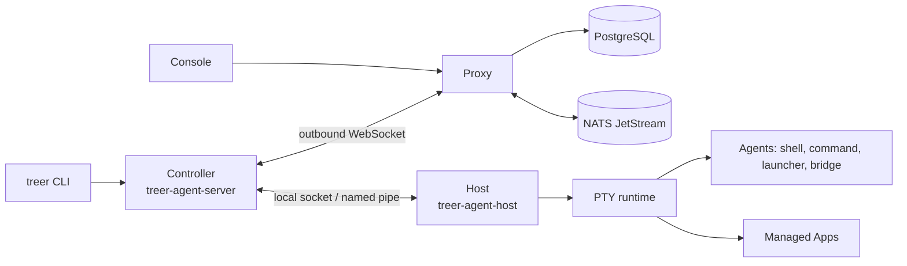

# Architecture

Treer separates durable coordination (the Proxy) from machine-local process
ownership (the Host). Everything between them is replaceable without losing
running work.

## Components and ownership

| Path | Owns |
| --- | --- |
| `crates/treer-proxy` | Public HTTP/WebSocket API, accounts and sessions, Policy, App identity, Core Message, workspace Tree, routing, ingress, audit, multi-Proxy coordination |
| `crates/treer-agent-server` | The machine **Controller**: Proxy link, local API, the full `treer` command parser and help, launch snapshots and recovery, service forwarding, per-workload HTTP proxy entries, Agent Interface registry, machine exec/file transfer, signed self-replacement, service-manager integration, TUI |
| `crates/treer-agent-host` | The stable **Host**: owns child processes and PTYs, idempotent mutations, bounded output replay. Knows nothing about Agents, prompts, workspaces or the Proxy |
| `crates/treer-agent-runtime` | PTY lifecycle, bounded output ring, working-directory containment |
| `crates/treer-cli` | Thin `treer` client: sends argv/stdin to the Controller and streams stdout/stderr/exit, terminal bytes and local forward listeners |
| `crates/treer-protocol` | Shared Proxy/Controller/browser/CLI wire models and capability constants |
| `crates/treer-host-protocol` | Controller-to-Host frames |
| `crates/treer-platform` | Local IPC (Unix sockets, Windows named pipes), user paths, private files, environment filtering, Windows process ownership |
| `launchers/agent` | Agent launcher `treer-launch`: native Codex/Claude adapters, one Agent Interface Server and browser UI per Agent |
| `apps/` | Workspace Apps: ordinary services with their own configuration, secrets and state |
| `web/` | The Console (React), deployable as a static site, Worker, nginx image or served by the Proxy |
| `deploy/updater` | Self-hosted Compose image updater; the only component with `docker.sock` |

Rules that keep these boundaries:

- Wire models live in the protocol crates; process mechanics stay below
  product logic. The Host must stay product-agnostic so it never needs
  replacing to ship a feature.
- The thin CLI contains no command syntax. Help and the embedded skills
  (`treer --skill`) come from the connected Controller, so they always match
  the Controller version.
- Every distributed lookup is scoped by workspace before machine or Agent ID.
- Launchers and Apps are ordinary workloads. Core has no provider catalog,
  provider-specific Agent kind or App installer.

## Process model on a machine

One enrolled machine installation runs:

- **Host** (`treer-agent-host`): a long-lived process started detached
  (`nohup`, own process group) by default, or under systemd/launchd when
  selected with `--service-mode`, or in the foreground for diagnosis. On
  Windows it is a detached user process holding a kill-on-close Job Object.
  The Host owns every workload process and its PTY, keeps a bounded output ring
  per stream epoch, and retains the latest completed process records so a new
  Controller can rebuild state.
- **Controller** (`treer-agent-server`): spawned and supervised by the Host.
  It connects outward to the Proxy, serves the authenticated loopback local API
  (first free port from `127.0.0.1:8790`), and translates Proxy commands into
  Host operations. It can be replaced (`service restart-controller`, signed
  update) while the Host and all workloads keep running.
- **Workloads**: Agents (`shell`, `command`, `bridge`) and Apps (`app`) are the
  same Host process contract. Each keeps its stable Agent ID and workload
  credential across process replacements; `run_generation` identifies the
  attempt.

The Controller-to-Host link is a length-prefixed bincode protocol over a Unix
socket (`h-<16-hex hash of server_id>.sock` in the per-user runtime directory)
or a current-user Windows named pipe. Mutating Host commands carry operation
IDs, so retries never spawn or stop twice.

Every workload receives `TREER_WORKSPACE_ID`, `TREER_SERVER_ID`,
`TREER_AGENT_ID`, `TREER_AGENT_SERVER_URL`, its private workload credential,
`TREER_BIN`, standard `http_proxy`/`https_proxy` variables pointing at its own
HTTP proxy entry, `TREER_PROXY_URL` for Apps, and
`TREER_AGENT_PRIVATE_STATE_DIR` when the private-state directory passes its
safety checks. Host and Controller start from a filtered environment: Treer
identity variables and loopback proxy settings from the launching shell are
removed so a Controller started from inside an Agent cannot inherit its
identity.

### Launches and recovery

The Controller is the single owner of process recovery for Agents and Apps.
Before spawning, it persists a launch snapshot (Agent ID, argv, cwd, terminal
size, credential, desired state) in `<state dir>/<server_id>-agent-startup.json`.
Start, stop, restart, bootstrap and recovery share one Controller lock and
consult Host inventory first, so a surviving process is attached, never
duplicated.

- On a Controller restart, surviving processes are attached.
- On a new Host epoch (Host restart, reboot followed by `restore`), intended
  running workloads are relaunched once after the Proxy confirms their
  identities are still valid; explicitly stopped, deleted or revoked ones stay
  stopped.
- Enabled Apps are restarted on the five-second heartbeat when their process
  is missing. Ordinary Agents are not restarted after a normal exit.
- Recovery recreates processes, not in-memory conversations, open TCP sessions
  or output lost with a previous Host.

Bare command names are resolved only through absolute directories in the
workload's final `PATH`; relative commands and cwd search are rejected. Treer
does not start at boot: `treer-agent-server restore --workspace ID` (or an
operator-chosen systemd/launchd unit) does that.

Deleted Agents are fenced: the Controller keeps a bounded durable list of
denied IDs so late creates or stale Host inventory cannot resurrect them, and
removes the Agent's private-state directory after the Proxy confirms deletion.

### Per-Agent private state

Each Agent gets `<state dir>/agent-private/<server_id>/<agent_id>` (0700, or a
current-user DACL on Windows), outside the working tree. The variable is
withheld when the directory would be inside the cwd on a visible path or inside
a version-controlled tree. The local API offers reservations with per-Agent
(256 MiB) and per-machine (4 GiB) quotas. It is a cooperative convenience for
launchers, not isolation.

## Proxy and cluster

The Proxy is stateless apart from PostgreSQL and optional NATS. Any number of
replicas can serve the same deployment; load balancers need no sticky
sessions.

- **Without NATS** one Proxy runs the same event contract in process.
- **With NATS** (`TREER_NATS_URL`):
  - JetStream KV holds short-lived machine-ownership leases (one owning Proxy
    per `server_id`, renewed by heartbeat, created with create-if-absent and
    revision checks) and a separate bucket of machine snapshots;
  - file-backed KV holds the latest workspace/rename/deletion projections so
    reconnecting replicas do not miss control-plane changes;
  - Core NATS request/reply routes commands, terminal sessions and service
    streams to the Proxy that owns the target machine;
  - a JetStream stream stores versioned domain events
    (`<prefix>.workspace_<id>.<action>`). PTY and TCP bytes never enter
    JetStream.

A new authenticated machine connection takes ownership immediately and the
previous socket is closed with `duplicate_machine_connection`; the loser keeps
reconnecting with backoff. The Proxy pings machine sockets at least every 20
seconds and closes silent ones within 60, so a sleeping laptop is not shown
Online. Every heartbeat rechecks the machine credential in PostgreSQL, so
revocation works even if NATS is down.

Machine registration advertises supported protocol versions and command
capabilities. The Proxy sends capability-gated commands only to Controllers
that declare them; a Controller answers unknown commands with
`unsupported_command` without dropping the connection. This is what allows
Proxies and Controllers to be upgraded independently.

## Workspaces, identity and the Tree

Organizations contain members, groups and workspaces. A workspace is
`organization` (all members) or `restricted` (direct/group grants, the creator
and organization owners/admins). Grants are `owner` or `member`.

Principals are humans (cookie sessions; Bearer for native clients), machines
(enrollment-issued credential), managed workloads (workload credential,
forwarded by their Controller), and Apps acting for a human or Agent
(service-audience tokens). The Proxy derives every subject from credentials;
caller-supplied IDs are never trusted.

The **workspace Tree** stores folders and placements for Agents and Apps in
PostgreSQL. Names are unique within a folder; IDs (`ag_…`, `app_…`) are the
durable keys. CLI targets accept an ID, an absolute or relative Tree path, a
sibling name or `self`; relative paths start at the caller's folder (root for
operators). New workloads are reserved with their name and folder in one
transaction before the process starts; an Agent or App caller that omits
`--folder` creates into its own folder. Tree mutations serialize on the
workspace row and bump `workspaces.tree_revision`. The Tree is presentation and
a Policy input; it never changes process cwd, machine or identity.

## Core Message

Core stores immutable Message bodies, ordered context edges (a per-workspace
DAG), recipient snapshots, per-recipient delivery state, sender-scoped
idempotency records and a body-free transactional outbox. `receive` repeats an
unacknowledged delivery until `ack`; history reads never acknowledge. A context
edge never grants visibility of its parent.

- Agents use `treer message ...`; the Controller forwards under the workload
  identity and the Proxy evaluates `message.*` Policy.
- Browser Apps call `/api/apps/{service_id}/messages...` with a
  service-audience token and reach the same implementation.
- Managed Apps can expose logical sub-addresses (`/path/to/app/child`), send
  with `--from-endpoint`, and receive/ack one endpoint of their own mailbox
  (`app_endpoint`, `message.endpoint-inbox.v1`); see [App-owned trees](app-tree.md).

A Message never wakes an Agent; prompting is a separate, separately authorized
action. Message routes are enabled by `TREER_ENABLE_CORE_MESSAGES` (on in the
Compose and single-container deployments; a rollout switch, not a security
boundary).

## Agents and the Agent Interface

An Agent is a PTY process. Terminal attach, raw input, resize, stop and delete
are always Host operations. An Agent may additionally register one **Agent
Interface Server (AIS)** with its local Controller (`treer interface register`):
a loopback HTTP server whose `GET /v1/manifest` declares capabilities such as
`prompt.submit`, `prompt.queue`, `prompt.notify`, `prompt.queue.read`,
`transcript.read` and `state.observe`, plus an optional `ui_path` for an
embedded browser UI. Registration is bound to the Agent's own credential and
process; after a Controller restart a cached descriptor is restored only if the
same process is still alive and its manifest revalidates.

When AIS is present the Controller routes prompts and transcript reads to it:

- `treer agent prompt` defaults to **queue** delivery (`POST /v1/prompts`):
  idle targets start immediately, busy ones queue FIFO. `--steer` inserts into
  the active turn. Missing queue support returns `queue_unsupported`; Treer
  never silently falls back to typing into the terminal.
- The launcher persists each submission and returns a receipt; `--wait`
  follows that receipt. `--notify` asks the launcher to send one idempotent
  Core Message on completion.
- The sender is attested by the Proxy from the authenticated caller and
  forwarded by the Controller; prompt bodies cannot set it.

The Controller injects provenance headers on requests it forwards to an AIS
(`X-Treer-Interface-Source: controller-api` for semantic calls, `proxy-ui` for
browser UI traffic, plus the target Agent ID and instance ID). The launcher
rejects browser-originated requests without the expected markers and checks
`Host` against its loopback listener, which closes DNS-rebinding paths. These
markers defend against browsers, not against same-user local processes.

The [Agent launcher](../launchers/agent/README.md) is the reference AIS: one
native Rust runtime with Codex (`codex app-server`) and Claude Code
(stream-JSON) adapters, one Treer Agent per harness session, and a shared UI.
It ships as the `treer-launch` release executable, installed and updated
with the other Treer binaries. `bridge` Agents are for providers that
run outside the Host: their prompts go to a bounded Controller-local queue the
bridge reads from `GET /api/agents/{id}/prompt-queue`.

### Embedding an Agent UI in the Console

With a wildcard apps domain, each Agent UI is served on its own origin
`https://ag-<32 hex>.<apps domain>/`, so its JavaScript never shares the Console
or Proxy origin. Embedding uses a handshake because a third-party iframe cannot
perform a top-level login:

1. The Console asks
   `POST /api/workspaces/{ws}/agents/{id}/interface/embed-authorization` for a
   30-second single-use code (human session, membership, and Policy
   `agent.output.read` plus `agent.prompt`).
2. The iframe loads a Proxy-owned bootstrap page at `/.treer/embed` on the
   Agent origin. The page announces a nonce hash to the Console by
   `postMessage`, receives the code, and redeems it at `/.treer/embed/session`
   for a host-only partitioned session cookie
   (`__Host-…; Secure; HttpOnly; SameSite=None; Partitioned`).
3. The page verifies the cookie comes back, then navigates to the Agent UI.
   Consoles that support reuse first ask `/.treer/embed/check` whether a live
   session already exists in this partition and skip minting. A hidden
   "prewarm" handshake may run when the user hovers a Tree row.
4. Every request through the Agent origin rechecks membership and the
   interface Policy pair; WebSockets are rechecked about every 30 seconds and
   closed on logout or revocation.

If the browser blocks partitioned cookies the Console falls back to the
Proxy-origin tunnel `/api/workspaces/{ws}/agents/{id}/interface/ui/`, unless the
operator sets `--agent-embed-fallback refuse`. Without a wildcard domain only
that tunnel exists. The Worker and the Proxy-served Console send
`frame-src 'self' <Proxy origin> https://*.<apps domain>` (the wildcard only when
an apps domain is configured); the nginx image sets no `frame-src`.

## Managed Apps and App identity

A **Managed App** is a durable Proxy record for one command on one machine with
one HTTP UI port. Creating it allocates, in one transaction, a stable runtime
workload, a machine service and an owned virtual host, and, with wildcard
ingress, a platform origin `https://svc-<service id>.<apps domain>/`
(workspace login by default; `--public` opts into anonymous access).
`treer app update` changes cwd/command/args under a monotonically increasing
startup revision while keeping IDs, credentials and routes. Apps share the
Agent lifecycle (`treer agent start|stop|restart|read`). Core does not install
packages, inject secrets or migrate App data.

App identity:

- The App's `service_id` is its OAuth client ID. Human authorization uses
  Authorization Code with S256 PKCE, single-use hashed codes and redirect
  origins from the service's ingress; the token is audience-bound to the
  service.
- Requests arriving through workspace ingress or the Console App UI tunnel
  (`/api/workspaces/{ws}/apps/{id}/ui/`) carry a fresh 60-second
  `X-Treer-Identity-Token` for the current human, after untrusted `X-Treer-*`
  headers are stripped. Apps verify it with `/.treer/apps/identity/verify`
  and fall back to OAuth only when it is absent.
- Agents obtain 60-second Ed25519 workload tokens for a service
  (`treer token create`), or get them injected automatically by their HTTP
  proxy entry. Services verify with `/.well-known/jwks.json` or
  `POST /.treer/identity/verify`.
- `GET /api/apps/{service_id}/directory` lists visible humans and Agents with
  their Tree paths (paths only when the caller may read the Tree).

Apps own their data permissions and Origin defenses; see the
[App guidelines](../apps/GUIDELINES.md).

**App email** (`app.email.v1`). The Cloudflare sender credentials stay in the
Proxy, so Apps send through Core: `POST /api/apps/{service_id}/email` with the
App's service token, or `treer email send` (Controller `POST /api/email`,
Proxy `/agent/workspaces/{ws}/email`). Both admit only a Managed App runtime on
its own machine, evaluate `email.send` on its `machine.service` (status lookup
`GET .../email/{idempotency_key}` and `treer email status` check ownership
only), and share one
store: `app_email_sends` holds per-App idempotency keys, request fingerprints
and state; `app_email_attempts` is the body-free audit and hourly rate history.
The recipient is `to` (any address) or `to_member` (a workspace member's user
ID, resolved by Core to that member's verified account email).
Email is not Core Message and wakes no Agent; the App owns any thread mapping.

## Policy

Every governed request is evaluated as subject/action/resource after
authentication and workspace scoping. Actions cover Agent control
(`agent.create|stop|prompt|input|output.read|startup.*|tree.*|...`), launch
profiles, `machine.exec|file.read|file.write|service|update|delete`, services
and ingress, `identity.token.issue`, `network.*`, `message.*`, `email.send` and
`workspace.audit.read`.

The effective Policy, in order:

1. a **Policy Provider**: an owner-selected private Managed App implementing
   `treer.policy-provider/v1`, whose bundle the Proxy fetches over a bounded
   Controller loopback command, validates, compiles and evaluates locally (see
   [Policy Provider protocol](policy-provider.md));
2. otherwise a stored workspace Policy document;
3. otherwise the built-in **Treer Default**: monitor mode, allow.

Schema 2 rules can match Tree paths (`/team/*`, `/infra/**`) and folder
relations. Tree facts are read from PostgreSQL per request, never from the
bundle or the caller; if the Tree changes during evaluation the request fails
with `policy_tree_changed`. Path rules authorize by current position; they are
not containment, and anyone with `agent.tree.manage` can move nodes.

Owner recovery is outside delegated Policy: Provider selection/removal,
installing the default Policy App and owner Tree management stay available
even if rules deny everything. `workspace.audit.read` requires an owner or an
explicit enforce-mode allow.

## Routing and ingress

Machines only connect outward. All cross-machine traffic flows through the
Proxy over the Controller's WebSocket link (and NATS between replicas).

**Services.** `treer service register` records a TCP/HTTP endpoint owned by the
calling Agent (or chosen by an operator) on its machine. Opening a service
authenticates the caller and checks Policy, then multiplexes a byte stream to
the destination Controller, which connects only to the registered endpoint.
Data, window updates, half-close and reset are preserved; open streams are
periodically re-authorized and closed when the service is deleted. There is no
transparent capture and no OS DNS change.

**Client side.**

- `treer service forward ID --listen 127.0.0.1:PORT` binds a local listener.
- Every managed workload gets its own loopback HTTP proxy entry; its port
  fixes the caller identity. `http://SERVICE_ID.treer/` or
  `http://NAME.treer/` (names resolved per request, case-insensitive) reaches a
  registered service with `X-Treer-Identity-Token` and, if absent, a Bearer
  token injected. CONNECT works for HTTPS and raw TCP (e.g. SSH) without
  injection. Other destinations are fetched directly from the source machine.
- `treer agent address TARGET` returns an Agent's primary HTTP service URL
  (`service register --primary`).

**Ingress** (requires `TREER_INGRESS_PUBLIC_URL`, a wildcard DNS/TLS domain):

| Host | Serves |
| --- | --- |
| `svc-<service id>.<apps domain>` | A published service or Managed App; `workspace` access (member session or service token) or `public` (anonymous, rate/size/time limited) |
| `ag-<agent id>.<apps domain>` | An Agent's interface UI; member + interface Policy, standalone login or embed session |

Workspace ingress login is a browser-bound flow (`/.treer/ingress/authorize`,
verifier cookie, single-use five-minute code) that yields a 12-hour ingress
session on that host. Public ingress applies per-client and per-service token
buckets and in-flight limits; the client address is the TCP peer unless
`--ingress-trusted-proxies` and `--ingress-client-ip-header` name a trusted
front. The verified address is forwarded as `X-Treer-Client-IP`.

**Raw TCP**: with `TREER_PUBLIC_TCP_PORT_RANGE` configured,
`treer service publish ID --tcp --access public` allocates an anonymous public
port. No identity is injected.

**Console tunnels.** Without isolated origins, the Console reaches App UIs,
Agent UIs and legacy virtual hosts through authenticated Proxy-origin paths
(`/apps/{id}/ui/`, `/agents/{id}/interface/ui/`, `/virtual-hosts/{host}/proxy/`).
When the Console and Proxy share one origin these tunnels are refused, because
App content must never run on the Console origin.

**Terminals** are revisioned byte streams: the Host keeps a bounded ring per
stream epoch, reconnects send their last cursor, and the Host returns later
chunks plus a gap flag if the ring moved past it; a replay the ring truncated
starts at the next escape-sequence or line boundary. This works across Proxy
replicas. Delivery is lossless: the Controller relay resyncs from the Host on
any skipped revision, and the browser acknowledges parsed bytes so at most a
256 KiB window is unacknowledged. A browser that stays behind long enough to
fill its Proxy queue is detached and resumes from its cursor; if output past
the cursor was already shown it resets and takes the full replay.

**Machine exec and files** reuse the Proxy-to-Controller command path. Exec is
one argv with a 30-second ceiling, bounded output and a minimal environment
without Treer credentials. Files stay beneath the enrolled root and refuse the
Treer state directory: `treer machine put/get` (64 KiB acknowledged chunks,
SHA-256 verified, 128 MiB default limit) and the Console's resumable chunked
upload.

## Machine hardware metrics

A Controller advertising `machine.metrics.v1` samples whole-machine CPU
utilization and RAM (`used = total - available`, via `sysinfo` with only CPU
and memory refresh) every five seconds into an in-memory history: raw samples
for the last hour and per-minute means for the last 24 hours. NVIDIA GPUs
(utilization and memory per device) come from one long-running
`nvidia-smi --query-gpu=... --loop=5` child on Linux and Windows; without it
the response says `not_detected`, and macOS reports `unsupported`. Nothing is
persisted; a Controller restart starts an empty history.

`GET /api/workspaces/{ws}/machines/{id}/metrics?window_seconds=N` (also under
`/agent/...`, default 3600, at most 86400) sends the `machine_metrics` command
over the existing Controller connection and returns the window unchanged
(`Cache-Control: no-store`); the Proxy stores nothing. Windows up to one hour
return 5-second samples, longer ones minute means. Access follows machine
visibility in the workspace snapshot: members and the workspace's Agents may
read any machine, a machine credential only itself; there is no separate
Policy action because the data grants no control. Controllers without the
capability get `501 machine_metrics_unsupported`, offline machines
`503 server_offline`. `treer machine metrics <machine> [--window 15m]` calls
the same route.

## Controller update

Machines update independently of the control plane:

- From the Console or API, `POST /api/workspaces/{ws}/machines/{id}/controller-update`
  with `{"version":"vX.Y.Z"}` (authorized as `machine.exec`) sends the command
  to a Controller advertising `machine.controller-update.v2`; `GET` on the same
  path returns `idle|downloading|installing|restarting|failed|done`. The Proxy
  keeps only an in-memory record.
- Locally, `treer-agent-server update [--version V | --channel C]` runs the same
  install.

The Controller downloads `releases/V/manifest.json` and its detached signature
from the release distributor (default `https://releases.treer.ai/`), verifies
them against the trusted Ed25519 key, downloads `treer-agent-server`, `treer`
and `treer-agent-host` for its platform, checks size and SHA-256, and replaces
each binary in place, keeping one `<name>.old`. It then asks the Host for a
plain Controller restart; completion is the new Controller reporting the
version on reconnect. The new Host binary takes effect only on the next Host
restart (`service restart`), which stops workloads. See [Releases](releases.md).

## Data stores

| Store | Holds |
| --- | --- |
| PostgreSQL (`crates/treer-proxy/src/schema.sql`, migrated at Proxy startup) | Accounts, sessions, organizations, workspaces and grants, machine and workload credentials, launch profiles, Tree, services, ingresses, Apps, App OAuth codes, signing keys, Policy and Provider bindings, Core Message, App email audit, audit, traffic usage, upload state |
| NATS JetStream (optional) | Machine leases and snapshots, workspace projections, domain events; never authoritative for Messages or billing |
| Controller config (`~/.config/treer/agent-servers/`, `%LOCALAPPDATA%\Treer\agent-servers`) | `<server_id>-controller.json` / `-host.json`: Proxy URL, machine credential, root, listen address, service mode (0600) |
| Controller state (`~/.local/state/treer`, `$XDG_STATE_HOME/treer`, `TREER_STATE_DIR`, `%LOCALAPPDATA%\Treer\state`) | Installation identity per hostname, launch snapshots, deletion fences, transfer journals, interface cache, Agent private state, logs |
| Runtime directory (`$XDG_RUNTIME_DIR/treer` or private fallback) | Host socket |
| Enrolled root `.treer/` | Per-root local assets; refused by machine file APIs |
| App state | Each App's own directory/database (`TREER_APP_STATE_DIR`) |

Audit events for organization, workspace and Tree mutations are written in the
same transaction as the change; runtime lifecycle events are appended after
the Controller result on a best-effort basis. Audit retention defaults to 180
days (`--audit-retention-days`). Traffic usage is metered once per delivered
payload by route class in `traffic_usage_hourly`.

## Invariants

- Durable workspace state outlives the processes that create it; the Host
  outlives the Controller; the Controller can always rebuild from the Host.
- Stable IDs drive Policy, routing and relationships; names and paths are
  mutable labels.
- Core owns canonical Message data; channel Apps own presentation, transport
  and external mappings. External identities never become Treer principals
  because an App recorded them.
- Every mutation is idempotent under retry (operation IDs, idempotency keys,
  startup revisions); clients never blindly replay a mutation after an
  ambiguous failure.
- New Controller commands are capability-gated; old peers reject them without
  disconnecting.
- High-volume terminal and network bytes never become durable broker traffic.
- One OS account is one trust domain; see the [security model](security.md).
