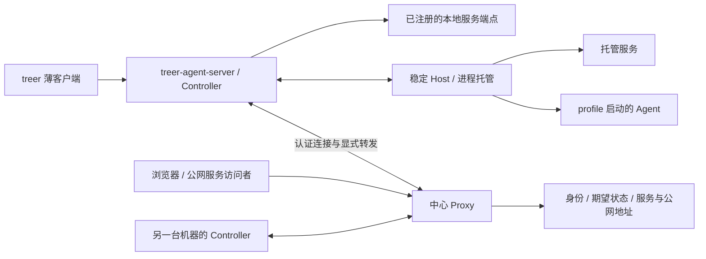

# Treer 核心收缩与显式互联、运行恢复计划

- 日期：2026-09-30。
- 状态：核心改造已在当前工作区实现并通过本地集成检查，尚未部署；落地差异与验收记录见第 14 节。前文保留设计建议，不把所有建议字段视为已实现协议。
- 源码核对基线：`62d117f`；现有行为仍以源码、测试和维护文档为准。
- 本计划取代继续建设原生 macOS 透明网络及跨平台网络捕获对齐的方向；既有实现与实验记录保留为迁移证据。

## 1. 产品目标与不可丢失的能力

Treer 提供最基础的身份认证、授权、机器互联、进程托管和服务接入。
用户决定 Agent 的运行环境；Treer 不承担沙箱、VPN、系统 DNS、透明出站代理或各平台网络环境的建设。

本次收缩必须保留并发展两项核心能力：

1. **显式端口发布**：把自己的监听端口注册到工作区内网，允许其他机器或 Agent 显式连接，并可以进一步发布到公网。
2. **可恢复运行**：机器关停、重启后，能够通过一个明确命令重新拉起之前应当运行的 Agent 和服务，恢复身份、服务地址和配置关系。开机自动执行是可选项，不是使用恢复能力的前提。

`treer` 保留为薄客户端；命令解析、帮助、skill 和业务编排移到现有 `treer-agent-server`，不是移到某个第三方 Agent 的应用服务器。

公网域名的含义是：Treer 为发布的服务自动分配稳定地址，替代 App 功能中由用户配置 host 的路径。它不意味着取消 App/服务发布，也不要求所有应用挤在同一个 HTTP 路径前缀下。

## 2. 责任边界

| 能力 | 目标归属 |
| --- | --- |
| 用户、工作区、机器、Agent/服务身份与撤销 | Treer |
| 经认证的机器出站连接、重连、命令与流传输 | Treer |
| Agent/服务启动、停止、状态与恢复 | Treer |
| 注册本地端口、工作区内显式转发、公网发布 | Treer |
| 平台生成的稳定公网域名与访问模式 | Treer；DNS/TLS 由平台部署统一配置 |
| 通用 PTY、日志/输出、终端接入 | Treer |
| Agent 厂商安装、默认参数、会话恢复方式 | profile / launcher |
| 代理变量、VPN、容器网络、系统 DNS、路由 | 用户环境 / profile / launcher |
| 容器、VM、操作系统账户隔离与沙箱 | 用户选择的外部运行环境 |
| App 自有数据、依赖、数据库迁移、业务认证 | App / 用户运维 |

保留现有 Core Message 和必要的服务身份接口，先不在同一轮重写消息系统、集群路由或全部 App。Voice、渠道集成等外围能力另行评估，不作为完成本计划的前置条件。

“移到 profile”意味着核心不再维护具体平台实现。不能把现有透明网络改名为官方插件后，继续承担同样的跨平台支持承诺。

## 3. 改造前基础与需要拆开的耦合

以下是当前实现，不代表目标已完成：

- [CLI](../../crates/treer-cli/src/main.rs) 同时承担解析、API 编排、等待、文件输入、网络代理和终端交互。
- [Controller 启动逻辑](../../crates/treer-agent-server/src/controller_launch.rs) 包含厂商命令、安装脚本、默认参数、交互式 shell 输入及网络包装。
- [网络环境注入](../../crates/treer-agent-server/src/controller_output.rs) 会设置或清空代理变量；`proxy-env` 仍不是普通、不受 Treer 管理的网络环境。
- [Controller 网络模块](../../crates/treer-agent-server/src/network.rs) 同时包含出站代理、流传输、本地 API 桥接和 namespace 内服务连接，不能整文件删除。
- [Agent startup store](../../crates/treer-agent-server/src/startup_store.rs) 已保存启动配置和凭据；新 Host epoch 可以恢复已登记的 Agent，但不是所有 Agent 的统一恢复契约。
- [Managed App](../../crates/treer-proxy/src/api/apps.rs) 已有持久化期望状态、替换运行实例和重连协调，不能因收缩 App 域名功能而删除这部分价值。
- [服务与 UI 入口](../../crates/treer-proxy/src/api/network.rs) 已支持 HTTP/WebSocket 转发，应提取保留的能力。
- [原生 macOS 网络](../../native/macos-network/README.md) 仍有已安装扩展、系统 DNS 和故障恢复验收缺口，停止继续追求平台对齐。

## 4. 目标架构



保留 Host 与 Controller 的分离：Controller 更新或重连不应杀死工作负载。Host 保持通用进程层，不加入厂商或网络环境特例。

共享协议只表达通用资源、身份、生命周期、端点和传输；不再为某个 Agent 厂商增加核心 kind、安装命令或专属运行规则。

## 5. 显式端口转发与公网发布

### 5.1 工作区内网是服务可达性，不是虚拟局域网

工作负载或操作者显式注册一个 Controller 可达的端点，获得稳定 `service_id`。
其他机器通过服务 ID 建立经过认证的连接，也可以把该连接绑定为自己机器上的本地端口。
普通应用使用这个本地端口，不需要修改系统路由或加入透明网络。

示例语义，命令名待实现时统一：

```text
treer service register --port 3000 --name preview
treer service forward <service-id> --listen 127.0.0.1:8080
treer service publish <service-id> --access workspace
```

第一条发布服务到工作区；第二条是调用方主动建立的本地转发；第三条为已有服务增加公网入口。
公网可达与匿名可访问是独立属性：`workspace` 需要 Treer 身份，`public` 是明确选择的匿名入口。

端点最小记录包含：稳定服务 ID、所属工作区/机器、所属 Agent 或服务主体、Controller 可达的目标地址和端口、协议、访问模式、发布状态与配置版本。
显示名称不参与身份验证，也不需要转换成虚拟 DNS 记录。

### 5.2 保留通用 TCP，优先完善 HTTP/WebSocket 公网入口

- 工作区私有转发支持显式 TCP 字节流，包括非 HTTP 协议；保留半关闭、背压、取消、连接上限和撤销能力。
- HTTP/WebSocket 服务通过平台生成的 HTTPS 地址发布，保留流式响应、升级连接和应用自身认证信息的正确转发。
- 非 HTTP TCP 如需直接向普通公网客户端发布，使用中心域名加平台分配的稳定端口。部署必须明确配置可分配的监听端口范围；不能把任意 TCP 假装成 HTTPS 子域名路由。
- 对需要 Treer 身份的非 HTTP 服务，调用方通过认证的 `service forward` 接入；直接公网 TCP 入口只能在明确公开时启用，应用可自行提供协议级认证。
- 原始公网 TCP 分配在私有 TCP 与 HTTP 发布稳定后交付；没有配置端口范围的部署明确返回不支持，不暗中开放机器端口。
- UDP 暂不作为本轮交付目标。迁移前列出现有 UDP 服务与使用者，给出外部运行环境替代路径，不能静默降级成 TCP。

服务端只允许连接已注册且获授权的端点；显式端口转发不重新演变成通用出站 SOCKS 服务。
Agent 可以发布自己声明的服务，operator 可以登记外部进程的服务；这将替代当前必须通过 Managed App 才能由 Agent 分配服务的限制，需要同步调整授权与文档。
“自己声明”建立资源归属，不宣称在未隔离的同账户环境中能证明某个监听端口只属于该 Agent。

### 5.3 平台自动分配域名，退出用户自定义 host

目标地址建议为 `https://<opaque-service-id>.<platform-service-domain>/`。
平台部署一次性配置服务基础域名、通配解析和证书；用户不再填写 hostname、CNAME 或证书。
这仍然是一个平台管理的域名体系，不是每个 App 的自定义域名功能。

- `service_id` 和公网地址独立于 PID、临时端口和运行实例，重启后不变。
- 保留 `workspace` / `public` 访问选择；默认需要工作区身份。
- App 仍是可托管、可发布、可恢复的服务，不删除 App 功能的这些部分。
- 现有 Agent UI 路径入口可以继续使用，不为了统一形式强制重写。
- 不建设自动兼容任意网站的 HTML/JavaScript 重写系统。
- 新服务只分配平台地址；旧自定义 host 先提供旧地址到新地址映射与迁移窗口，再停用相关写接口和界面。
- 迁移必须更新 App OAuth 的 redirect origin、service audience 绑定和旧 ingress 会话处理；不能只改浏览器展示的 URL。
- 内部虚拟 hostname 不再是必需资源；服务发现和转发改以服务 ID 为核心。

### 5.4 用户自带隔离环境的接入

Treer 默认连接 Controller 能到达的本地端点。服务在容器或 VM 中时，由用户的 launcher 建立端口映射或其他可达端点，再完成注册。
Treer 不探测、修复或安装每种容器平台的网络；也不替用户创建隔离环境。
同机多个 Agent 的端口分配必须显式避免冲突，可以由应用动态绑定端口后注册。不能再依赖每个 Agent 拥有独立 namespace，因此可以重复占用同一端口的旧假设必须消除。

## 6. Agent 与服务的统一恢复契约

### 6.1 恢复承诺

恢复的是已保存的运行声明、稳定身份、服务映射和应当运行的集合，不是关机前的进程内存、PTY 内容或未落盘任务。
Treer 恢复通用运行状态；Agent 的会话、任务进度和应用数据恢复，由对应运行时与持久化目录负责。

| 情况 | 预期行为 |
| --- | --- |
| Controller 更新/重启，Host 与进程存活 | 重新接管、更新状态，不重复启动 |
| Host 丢失或机器重启 | 执行恢复流程，重新创建应当运行的 Agent/服务 |
| 操作者主动停止一个工作负载 | 持久化 stopped，批量恢复不将它复活 |
| 临时关闭整台机器/停止控制服务 | 不改写各工作负载的持久化运行意图 |
| 删除工作负载、机器或撤销身份 | 恢复流程不能重新激活它 |
| 只注册了外部管理的服务端口 | 恢复注册关系；没有启动声明时不能承诺启动外部进程 |
| Agent 运行时支持 resume | launcher 使用保存的 session/thread ID 恢复会话 |
| Agent 运行时不支持 resume | 恢复进程和身份，明确显示新会话 |

明确区分机器恢复策略和进程退出重启策略。Agent 正常完成后默认标记停止，不进入无限循环；长驻服务可选择 `on-failure` 或 `always`，并使用有上限的退避。
Agent 异常退出但没有自动重启策略时，保留可手动恢复的失败状态。一次性任务可显式关闭机器恢复。

### 6.2 最小持久化模型

Agent 和托管服务复用同一组恢复字段，不必立即合并所有现有产品 API 或数据库表：

- 稳定工作负载 ID、机器/工作区归属和主体身份；本次运行另有 generation/attempt ID。
- 启动命令、argv、cwd、profile 来源及实际生效的配置快照。
- 非敏感环境配置、机器本地凭据引用和持久化数据路径。
- `desired_state`、机器恢复是否启用、进程退出重启策略、配置 revision。
- 服务 ID、端点注册规则、公网发布模式与稳定地址。
- 可选、由 launcher 管理的会话恢复引用；核心不解析厂商会话格式。

不能只保存 profile ID：profile 后续修改不应悄悄改变已有工作负载的恢复命令。更新运行配置需要显式采用新 revision。
创建可恢复工作负载时保存声明，不要求每个 Agent 在启动后自行补写 startup spec；保留显式配置覆盖能力。

中心持有资源归属、期望状态和非敏感配置的权威版本；机器保存启动所需的持久化快照及本地凭据引用。
中心撤销与 stopped 状态优先于旧快照。目标恢复流程先与中心核对版本和身份，再启动；中心暂不可用时显示等待并允许重试，不用旧快照越过撤销。
本轮不承诺离线恢复或机器磁盘丢失后的异机重建。状态必须保存在持久目录，不能依赖临时 socket、PID 或临时目录存活。
新建/更改运行意图须先可靠保存，再报告成功；机器突然断电不能把全部 running 误写成 stopped。

### 6.3 一个命令恢复

建议由现有 Server 二进制提供冷启动入口，避免薄 CLI 在 Server 不在线时无法发起恢复：

```text
treer-agent-server restore --workspace <workspace-id>
```

这个命令加载已登记的机器配置，启动或接回 Host/Controller，连接中心并执行恢复。它不要求重新 enrollment，也不要求用户手工逐个启动 Agent 或服务。
Server 已在线时，薄 CLI 可提供同一流程的远程入口，例如 `treer runtime restore --all`；这里的 all 仅指选定机器和工作区。

执行顺序：

1. 验证机器身份、获取当前期望状态和配置版本。
2. 检查 Host 中仍存活的实例，优先接回；核对进程身份而非仅看 PID。
3. 按工作负载 generation 和幂等操作 ID 启动缺失实例；并发 restore 不能重复拉起。
4. 工作负载重新注册实际端点，恢复稳定服务 ID 和平台入口绑定。
5. 输出逐项结果：已接回、已启动、等待端点、按 stopped 跳过、身份已撤销、配置/依赖失败。

一次失败不阻止其他独立工作负载恢复；再次运行只处理仍缺失的项。启动已完成但回执丢失时，通过 Host 实例清单核对，不能盲目重放。
进程 running、服务端口可达、应用业务就绪分别报告；通用恢复只承诺前两者，业务探测由显式应用配置决定。
缺少镜像、可执行文件、凭据、挂载目录或外部数据库时报告具体失败，不自动安装环境，也不升级成依赖调度平台。
开机自动恢复只是在用户选定的启动机制里调用同一入口；手动恢复必须先独立成立。

## 7. 身份分离与不提供沙箱的边界

Treer 提供可被外部隔离环境利用的身份分离接口：每个工作负载有自己的凭据、CLI 连接上下文和注册关系；机器/operator 凭据不注入 Agent。
Agent ID、显示名称、端口号或 argv 都不是身份凭证，认证以实际凭据绑定的主体为准。

本次讨论中“最基础的隔离”明确指 **CLI 及其 Agent 身份凭据分离**，不是 CI 任务沙箱。
同一个只读 CLI 二进制可以复用，但每个 Agent 的配置/凭据引用、挂载或注入的身份材料必须能够独立提供。
托管 Agent 的 CLI 使用显式 Agent 身份模式：凭据缺失或失效时报错，不回退读取机器/operator 的默认凭据。
任意指定 `--agent-id` 不会切换身份；Server 只接受凭据实际绑定的 Agent。

用户可以把某个 Agent 的 CLI、凭据和端点放进自己管理的独立账户、容器、VM 或其他隔离环境。
Treer 只要求该环境能访问必要的 Controller/Proxy 接口，并能提供要发布的端点；不理解或实施具体隔离技术。

在没有外部隔离时，同账户进程可能读取或使用彼此的凭据、文件和端口。此时 Treer 不防御同机恶意 Agent，不声称认证主体一定等于真正发起操作的进程。
独立凭据和私有文件权限用于正确配置与减少误用，不构成同账户对抗隔离。

这一边界不取消公网接口的认证、工作区归属校验、令牌撤销或防止远端跨工作区访问的检查。
保留工作负载、服务、机器和 operator 的凭据区分；服务转发按已认证的调用者授权，不从客户端提供的 Agent 名称推断权限。
不再对任意出站 socket 做 PID/后代进程归因，不承诺用户流量只能经过 Treer。

## 8. 薄 CLI 与服务端命令执行

### 8.1 客户端和 Server 的分工

| 薄客户端保留 | 现有 Agent Server 接管 |
| --- | --- |
| 选择地址、工作区、凭据等连接上下文 | 完整业务命令树与参数解析 |
| 原样传输 argv 和 stdin | 参数校验、资源解析、业务编排与等待 |
| stdout/stderr、终端 raw mode、窗口尺寸 | help、skill、业务输出格式与命令结果 |
| 取消、退出码和连接错误提示 | 当前调用者身份下的授权与执行 |
| 本地端口监听与字节转发 | 为服务转发请求认证、授权和建立连接 |

本地终端和端口转发是通用 I/O 能力，保留在薄客户端不会要求它理解服务或 Agent 的业务命令。
Server 返回通用会话/转发指令，由客户端执行固定传输操作；不能用这个机制要求客户端任意执行程序或读取任意本地文件。

### 8.2 传输契约

最小请求包含协议版本、request ID、原始 argv 数组和终端能力；身份由认证通道携带。
会话区分 stdin 数据/EOF、stdout、stderr、resize、cancel 和最终 exit 状态。不得拼接 argv 后交给 shell。
Server 使用不会退出守护进程的解析入口，将帮助、参数错误和退出码作为本次命令结果返回。

- `--body-file` 等客户端文件语义不能直接搬到 Server。新接口优先使用 shell 重定向/stdin；旧命令提供明确迁移错误或限期兼容，不偷换为读取服务器同名路径。
- 每次请求沿用用户/Agent 的真实身份，复用既有业务处理和授权，不以 Server 的 operator 身份执行所有命令。
- 有副作用的命令不能因断线自动重发；通过 request ID 查询或去重后再决定恢复。
- 业务 help 和 skill 由 Server 提供；本地只保留连接用法、客户端版本和连接失败诊断。冷启动命令属于 Server 二进制，不依赖这一连接。
- 保留浏览器、App 和移动端使用的结构化 API；将命令执行与现有处理逻辑共用，避免维护两套业务。
- 薄客户端版本协商只围绕通用传输能力；新增普通业务命令不要求同步升级客户端。

## 9. profile / launcher 收缩

保留通用 `command`、`args`、`cwd`，按实际需要增加环境配置、PTY 选择和恢复配置。凭据值不放进工作区共享的明文 profile。
默认运行用户明确指定的命令；需要 shell 初始化时由 profile 显式选择 shell/wrapper，不再注入固定延迟的终端输入来模拟启动。

厂商安装、自动下载、默认危险参数、信任确认、升级规避、会话 resume、容器和代理变量全部由用户选定的 launcher 负责。
移除核心 provider catalog 和命令名猜测依赖；前端按保存的 profile 展示，不再因为支持一个厂商而增加核心分支。
保留 AIS 通用能力与 UI 注册，厂商语义适配仍在外部适配器。

## 10. 分阶段实施与退出条件

### 阶段 0：冻结扩张并盘点迁移对象

- 停止透明网络、原生网络捕获、系统 DNS、隐式代理注入和用户自定义 host 的新增开发。
- 列出实际使用的 Agent startup specs、Managed Apps、外部服务、TCP/UDP、namespace 端口及自定义 host；盘点结果不包含凭据明文。
- 为每类旧配置确定迁移或显式不支持的结果，不先删除数据库或平台配置。
- 更新产品目标与路线图的目标状态说明，保持“当前已实现”与“计划迁移”分开。

退出条件：所有现有工作负载都能归入可迁移项或可说明的阻塞项。

### 阶段 1：建立不依赖透明网络的服务与身份接入

- 提取认证流传输、通用端点连接、UI/HTTP/WebSocket 代理；服务路由以稳定 ID 为中心。
- 增加普通网络运行路径：不注入/清空用户代理变量，不创建 namespace、TUN 或系统 resolver。
- 完成 Agent 发布自己声明的端口、另一台机器的显式 TCP 本地转发和访问撤销。
- 验证用户自带隔离环境中的凭据与 Controller 接入，核心无容器厂商分支。

退出条件：两台机器在未启用任何 Treer 网络捕获时可运行 Agent、相互调用并访问注册端口；AIS/UI 和现有托管服务有普通端点路径。

### 阶段 2：统一运行声明与机器恢复

- 从现有 Agent startup store 与 Managed App reconciler 提取共同契约，避免 Proxy 与 Controller 各自独立重启同一服务。
- 迁移稳定 ID、实际配置快照、运行意图、退出重启策略与服务绑定；本地秘密仍留在机器。
- 实现 Server 冷启动 restore 入口、在线恢复入口和逐项状态报告。
- 保留 Agent 默认不无限重启，以及长驻服务的有界自动重启策略。

退出条件：真实机器/测试 VM 重启后，一个命令恢复此前应运行的 Agent 与服务；重复执行不重复创建，主动停止的项不启动，ID 和服务地址不变。

### 阶段 3：平台地址替代自定义 host

- HTTP/WebSocket 服务自动分配平台域名，迁移 App 入口与身份回调。
- 移除新建自定义 host 的产品入口；旧地址经历有明确结束点的迁移窗口。
- 在支持监听端口范围的部署中完成显式公网 TCP 分配与回收；私有服务继续通过认证转发接入。

退出条件：用户无需配置域名即可发布服务；HTTP 和非 HTTP 公网接入的支持条件明确，身份模式和机器恢复后的地址稳定性通过验收。

### 阶段 4：CLI 迁移与 provider 特例退出

- 引入服务端命令会话，逐类迁移解析、help、skill、等待和输出。
- 同步更新嵌入 skill 的位置契约与文档检查器；现有 skill 源文件路径不必移动。
- 薄客户端保留通用 I/O，删除旧业务解析与 Git/SOCKS 代理入口。
- 核心启动路径改为通用声明，provider 安装与启动特例迁入外部 launcher。

退出条件：新增业务命令无需更新客户端；新增 Agent 厂商无需修改核心组件；文件输入、终端、取消、退出码和端口转发不回归。

### 阶段 5：删除旧网络并完成支持边界切换

- 删除 Linux 透明出站捕获、原生 macOS 网络后端、系统 DNS、虚拟地址映射和隐式代理注入。
- 移除不再需要的 Direct/Relay 出站分类、Direct 流量回执和任意出站网络策略；保留显式转发的流控、授权、撤销与必要观测。
- 网络历史数据按原保留规则处理，不把旧账本即时删除作为清理前提，也不新增计费系统。
- 清理旧客户端与协议兼容分支；先列兼容版本与切换要求，再停止支持，不静默改变旧命令的含义。
- 已安装的 macOS helper、resolver 文件和 Linux 残留需要明确的停用/卸载步骤。只处理经识别的 Treer 自有配置，不能靠删除仓库源码代替机器清理。

退出条件：发布与日常验证不再依赖透明网络、签名扩展或跨平台网络捕获；核心保留的互联和恢复验收全部通过。

## 11. 验证矩阵

| 边界 | 必需验证 |
| --- | --- |
| 基础身份 | 用户/Agent/operator 不混用；跨工作区拒绝；撤销后不可恢复或新建转发 |
| 无隔离默认 | 普通机器直接运行；文档明确同账户凭据并非对抗隔离，不声称恶意同机测试可通过 |
| 外部隔离接入 | 至少一个用户配置的隔离样例只能获得自己的身份材料，可调用 CLI 和发布服务；平台实现仍不负责创建该环境 |
| 私有 TCP | 跨机器二进制流、半关闭、背压、断线、访问撤销、本地监听释放 |
| 公网发布 | 平台域名自动分配、HTTP 流式与 WebSocket、private/public 切换、应用认证头与 cookie、App OAuth 回调迁移 |
| 原始公网 TCP | 分配端口范围、冲突、释放、权限与明确公开、恢复后地址稳定、未配置时明确拒绝 |
| Controller 热重启 | 既有进程存活、重新接管、没有重复启动 |
| 机器重启 | 真实重启后的批量恢复、稳定 ID/URL、持久化数据与端点重新注册 |
| 恢复失败与竞争 | 两个 restore 并发、启动后回执丢失、部分依赖缺失、配置 revision 变化、中心离线后重试 |
| 停止语义 | 显式 stop 不复活；机器停机不抹去运行意图；正常完成 Agent 不循环；服务重启退避有效 |
| 薄 CLI | argv 保真、stdin EOF、输出流、退出码、TTY resize/cancel、Server 不在线诊断、业务 help、旧客户端新命令 |
| 旧系统退出 | namespace 服务迁移、用户代理变量保留、旧 host 替换、旧网络显式拒绝与平台配置清理 |

按变更边界运行 focused tests；涉及身份、持久化、服务入口与恢复时运行对应 PostgreSQL 集成测试。
真实重启、真实转发和公网入口验收单独记录，不能用 mock、进程重启或编译通过替代。
不把 `just check` 作为每个阶段的默认命令；完整发布门禁按仓库发布流程执行。

## 12. 文档与源码交付清单

| 变更 | 同步维护的文档 / 源码边界 |
| --- | --- |
| 产品收缩 | [产品](../product.md)、[路线图](../roadmap.md)、[根 README](../../README.md) |
| 生命周期与端点契约 | [架构](../architecture.md)、`treer-protocol`、Controller、Host、Proxy |
| 身份与非沙箱承诺 | [安全模型](../security.md)、profile/凭据注入、服务和恢复授权 |
| 薄 CLI 与恢复命令 | [操作指南](../operator-guide.md)、[Treer skill](../../skills/treer/SKILL.md)、CLI/Server、文档检查器 |
| profile 与厂商退出 | [launchers](../../launchers/README.md)、安装流程、前端 profile 页面 |
| 服务、公网域名和 OAuth | [Apps](../../apps/README.md)、[部署](../../deploy/README.md)、Proxy 网络/身份模块、Web/移动端链接 |
| 用户自带隔离环境 | [macOS container skill](../../skills/treer-macos-container/SKILL.md)、安装 skill、外部 launcher 示例 |
| 验收与移除旧门禁 | [质量](../quality.md)、[Canary](../canary.md)、[发布](../releases.md)、CI/发布脚本 |

## 13. 完成标准

- 两台机器不依赖透明网络即可运行和管理 Agent，发布端口到工作区并按需发布公网。
- 公网地址由平台生成，用户无需设置 App 自定义 host；服务恢复后地址不变。
- 机器重启后，一个命令恢复此前应运行的 Agent 与托管服务；停止、删除和身份撤销被尊重。
- Treer 提供独立身份材料与接入接口；外部环境负责真正隔离，默认同账户运行不被描述成沙箱。
- `treer` 只有通用连接与 I/O，业务解析集中到现有 Agent Server。
- 新 Agent 厂商和特殊运行环境通过 profile/launcher 接入，不触发核心适配。
- 已移除能力不再隐藏在官方可选模式、发布脚本或必须通过的跨平台测试中。

## 14. 实现记录与交付边界

本轮按用户要求由三个 GPT-6.1-Sol Agent 分别实现薄 CLI、服务互联与公网入口、运行恢复与 profile 收缩，主 Agent 整合、交叉审查、修复传输边界并同步文档。

### 已落地

- `treer-cli` 只处理连接配置、身份、argv、标准输入输出、退出码、终端与本地监听 I/O。原命令解析、业务、help、skill 移到既有 `treer-agent-server`，通过认证 WebSocket 会话执行。业务参数不在客户端解析；传输配置只在命令之前解析。
- CLI 的 Agent 身份模式缺失凭据时明确失败，不回退读取 operator 身份。Controller 的进程环境覆盖继承的机器/operator/enrollment 凭据；Agent 获得自己的身份。此行为不防御同账户读文件或显式改环境，不构成沙箱。
- 新增 `service register/list/forward/publish/unpublish/delete`：工作区内认证 TCP 转发、HTTP/WebSocket 平台入口，以及显式匿名公网 TCP。服务 owner 从认证身份确定，不能指定另一个 Agent 冒充 owner。
- 新 HTTP 域名由稳定 service ID 生成，默认 workspace 认证；App 创建不再要求 hostname，非空自定义 hostname/slug 明确拒绝。旧别名与既有 ingress 暂保留读取兼容，不再用于系统 DNS 或透明捕获。
- 公网 TCP 仅在 Proxy 配置端口范围后开放，发布必须明确 `--tcp --access public`。映射在取消发布后禁用并保留端口，重新发布复用；删除服务释放记录。真实转发支持二进制与半关闭，取消/撤销发 Reset 清理远端流。
- 普通 Agent 在首次启动前保存稳定身份、实际 argv、cwd、终端尺寸与恢复意图。恢复以 Host 实际进程清单为准，先接管再补启动；每次缺失进程的启动尝试使用持久化新 generation，避免旧成功回执阻止重试。
- Proxy 持久化停止/取消 startup 意图；Controller 在恢复前验证身份和停止状态。主动 stop/delete/revoke 不复活，正常成功退出不循环，失败可手动重试。Managed App 保留原有中心 desired-state 调度，排除在普通 Agent 快照之外，避免双重托管。
- `treer-agent-server restore --workspace ID` 支持 Controller 尚未启动的情况；已运行时使用 `treer runtime restore --all`。报告涵盖 Agent、App、服务端点及部分失败。服务注册本身不托管外部进程，无法连接时返回 `waiting_endpoint`。
- 删除 Controller 的 namespace/TUN/SOCKS/代理变量注入、Direct/UDP/outbox 与原生 macOS helper 实现、相应依赖和必须通过的旧门禁。默认 plain；旧网络模式需显式迁移。历史协议解码/数据读取及研究记录保留，旧能力不会静默启用。
- 移除核心 provider 安装目录、自动检测安装和 recipe provider 推断。Web 创建入口收敛为 Terminal、自定义命令、保存的 profile；移动端不再提供 provider catalog。profile 直接执行 argv，网络、容器、软件安装由用户的 launcher 配置。

### 有意采用的最小实现

没有新增一套覆盖 Agent/App 的通用调度数据库。普通 Agent 使用机器本地 launch snapshot 加 Proxy 身份/停止意图，Managed App 继续使用已有中心记录。需要保留本机状态目录，不能据此承诺丢盘后重建机器。也没有新增任务依赖 DAG、跨机迁移、任意协议健康检查或 provider 会话恢复。

外部 TCP 服务可由保存的 Agent 命令托管，HTTP 服务可用 Managed App。仅注册外部端口不等于监督其进程。工作区转发仍经过中心连接，未增加 VPN、系统路由、虚拟 DNS 或普通互联网出口代理。

### 验证记录与剩余验收

- Controller 显式 TCP 测试覆盖真实 socket 二进制、双向 EOF、窗口背压、取消、断线与旧帧隔离。
- CLI 传输测试覆盖原始 argv、stdin/EOF、独立输出流与退出码、凭据不回退、拒绝跨 origin、认证转发与半关闭；另有真实 Host/Controller 子进程集成测试。
- 恢复测试覆盖并发、丢失启动回执、过期缓存、持久化 stop、撤销、失败重试与稳定身份。冷启动测试使用真实 Host 和生产 ControllerRuntime，关闭后重开 Host 并核验真实 PTY 输出；其中心 active-ID 验证为 fixture，不代表完整机器重启验收。
- PostgreSQL 测试覆盖 ingress/App 稳定平台地址、服务身份归属、停止意图和稳定公网 TCP 分配。真实 Proxy socket 测试覆盖私网 Policy 撤销、公网半关闭和取消发布后关闭。
- Web 已进行 TypeScript/构建与创建流程、恢复命令的浏览器检查。移动端改动尚未通过完整原生构建。
- 最终集成：六个受影响 Rust 包的测试通过（Proxy 使用隔离 PostgreSQL），严格 Clippy、格式、文档链接与 diff 检查通过；额外显式运行的真实 Host 冷恢复、真实 CLI/Controller、配置公网 TCP 三项默认 ignored 测试均通过。Web TypeScript/production build 和 32 项浏览器测试通过。
- 最终审查修复了机器认证 restore 路由缺失、跨机器恢复拒绝、超过 256 个 Agent 的分批验证、伪造 Host header 影响 CLI 回环目标、stdin 背压导致取消受阻、撤销后远端流未 Reset，以及旧 ingress 查找仍依赖自定义 host 等集成问题。
- 尚未进行物理机器重启、真实两机/多 Proxy NATS、公网 DNS/TLS/防火墙和原生移动端部署验收。数据库、Host、Controller 和监听端口验证均使用隔离临时资源；没有部署或重启现有 Treer 安装。
- NATS/live Voice 等环境开关未配置的既有测试会提前返回，其 `ok` 不计作真实外部集成证据。实际交互终端的 raw-mode/resize 路径尚未人工验收。

上线前先迁移旧 namespace 端口和代理依赖，再切 plain 模式；升级 Proxy 与 Controller/CLI，按部署环境配置 wildcard 域名及可选 TCP 端口；最后在真实机器上执行 stop/restore/publication/revoke 验收。已安装的原生网络扩展必须通过 OS 正常停用/卸载，删除仓库源码不会改变其安装状态。
