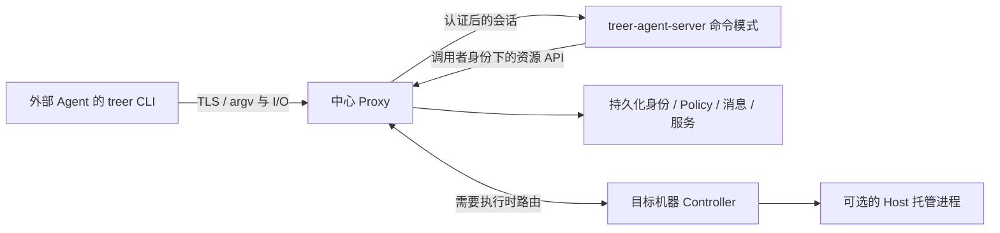

# 外部 Agent 身份与远程 CLI 接入计划

- 日期：2026-09-30。
- 状态：设计草案，尚未实现。用户本轮仅要求计划；本文件不授权开始实现或部署。
- 源码基线：`9b77581`，即已提交的核心收缩、显式服务转发与恢复改造。
- 延续 [核心收缩计划](2026-09-30-core-simplification-plan.md)：认证和互联属于 Treer，运行环境与隔离由用户决定，命令解析保留在既有 `treer-agent-server`。
- 以下字段、路由和新增命令均为拟议契约，不是当前可执行接口。

## 1. 目标和范围

一个未由 Treer Host 启动的 Agent，只需安装 `treer` 薄客户端、获得工作区内的独立身份凭据，并能访问中心地址，就可以参与协作。它可以运行在用户的终端、容器、VM、CI 或其他 Agent 平台中。

基础接入不要求本地 Host、Controller、PID 登记、常驻连接或虚构的 machine。CLI 仍只处理通用连接、凭据和 I/O；业务 argv 仍由 Agent Server 解析。

本轮设计分为两项可独立交付的能力：

1. 必需：独立 Agent 身份、公网 CLI 接入、消息与授权资源操作。
2. 后续可选：外部环境主动建立反向连接，使其本地服务可被工作区访问和发布。

不引入托管外部 Agent 进程、远程注入、沙箱、VPN、透明代理、厂商安装或对话恢复协议。外部 Agent 不因为持有 Treer 身份就变成 Host 托管进程。

## 2. 当前为什么不能直接接入

| 现有边界 | 当前约束 | 需要调整的方向 |
| --- | --- | --- |
| [薄 CLI](../../crates/treer-cli/src/main.rs) | 可以指定 URL，但默认身份配置围绕本地 Controller 和受管 Agent | 增加明确的远程 Agent 凭据配置，保留已有本地入口 |
| [Controller 认证](../../crates/treer-agent-server/src/controller.rs) | 从本地进程表取 Agent 并比较 workload credential | 远程调用身份由中心验证，不依赖本地进程表 |
| [Proxy Agent 认证](../../crates/treer-proxy/src/auth/machines.rs) | 先有 machine session，再验证绑定 machine 的 Agent 凭据 | 新增独立 Agent 认证入口，保留旧机器链路约束 |
| [数据库](../../crates/treer-proxy/src/schema.sql) | `agent_credentials.server_id` 必填；身份元数据与在线快照分散 | 增加持久化身份记录，运行位置作为独立关系 |
| [Policy subject](../../crates/treer-proxy/src/api/agents/policy.rs) | 构建 Agent subject 还依赖 `state.resolve_agent` 的运行时快照 | 从已认证的持久化身份构建 subject，单独解析执行目标 |
| [服务端命令](../../crates/treer-agent-server/src/cli_command.rs) | 调用 Controller 本地 API，部分命令假设一定有 `TREER_SERVER_ID` | 显式传入调用者上下文和后端，允许调用者没有托管 machine |
| [CLI 会话](../../crates/treer-agent-server/src/cli_session.rs) | 会话依赖 Controller 配置的本地 API 地址 | 同一会话协议支持中心部署的无 Host 命令服务 |

因此，这不是仅增加一个 `--remote` 参数。需要同时拆开身份解析、运行时寻址和命令执行位置，否则外部 Agent 仍会依赖某个虚构或在线的受管进程。

## 3. 身份和运行实例分开

Agent 是可认证的工作区成员；Runtime 是可选的托管进程。两者使用明确关联，不能继续用一个必填 `server_id` 同时表达身份归属、调用者位置和命令目标。

| 概念 | 最小信息 | 生命周期 |
| --- | --- | --- |
| Agent 身份 | 稳定 `agent_id`、workspace、名称、创建者、启用/撤销状态 | 独立于进程在线状态 |
| Agent 凭据 | 凭据标识、secret hash、身份、授权范围、有效期/撤销状态、签发来源 | 可单独撤销和轮换，不作为身份 ID |
| 托管 Runtime 绑定 | Agent、machine、受管运行实例/代次 | 可缺省；已有 Host 恢复仍负责此关系 |
| 服务 owner | 工作区和真实拥有者 Agent/操作者 | 不以当前连接位置代替所有权 |
| 服务 endpoint | Controller 可达地址，或后续的外部连接 lease | 描述可达性，不授予所有权 |

第一版只需支持每个身份零个或一个当前受管 Runtime，不建设多实例调度器。现有受管 Agent 的 ID、消息 principal、服务归属必须保持不变。

停止受管进程与撤销身份是两个操作。保留已有 stop 禁止恢复的语义，显式 delete/revoke 禁止后续使用凭据。外部 Agent 没有 Treer startup spec；其身份也不因长时间未调用 CLI 而自动删除。

Web/目录应显示“外部管理”，可附 `last_seen_at`。最近调用过 CLI 不代表外部进程仍在运行；没有 Runtime 的对象不伪造 PID、machine 或 running 状态。

## 4. 凭据如何交给外部 Agent

推荐第一版由已认证、获授权的工作区用户在 Web 创建外部 Agent 身份并签发凭据。现有管理入口以后可提供同等操作；不把首次授权流程塞回薄 CLI 的业务解析器。

操作流程：

1. 用户选择 workspace、Agent 名称和授权范围，创建独立身份。
2. 中心签发可撤销的 Agent 凭据，只在签发时返回明文，服务端保存 hash。
3. 用户把中心 URL 和凭据注入自己启动的运行环境；可用私有凭据文件或环境变量。
4. CLI 建立认证会话，中心从凭据确定 Agent 身份；调用方提供的 ID/workspace 只能做一致性校验。
5. 用户可撤销或轮换凭据；轮换保持 `agent_id` 和消息历史不变。

建议使用一个连接配置，包含 endpoint、workspace 和凭据引用。配置文件的精确格式在实现前统一，但不得要求复制整台机器的 Controller 配置或 operator token。令牌缺失/失效时明确报错，不回退到其他身份。

已有受管 Agent 使用同一种身份模型，但原有 workload credential 必须继续受其 machine 撤销约束。迁移不能把旧机器凭据自动升级成独立远程凭据。外部凭据由用户显式签发，不要求绑定 machine。

Treer 保证接口按提交的凭据识别调用者，不证明一个凭据只被一个物理进程使用。同账户环境默认不设防；需要真正分离时，用户只将该 Agent 的凭据和 CLI 放入自己选择的隔离环境。

## 5. 一条公网入口，解析仍由 Agent Server 承担

使用既有 `treer-agent-server` 二进制，增加不要求 Host socket 的命令模式。它复用当前 parser、help、skill 和命令会话实现，不创建另一个 CLI 项目，也不在 Proxy 中复制参数解析。命令模式只处理命令，不初始化 PTY runtime、机器 enrollment 或本地进程快照。

公网只有 Proxy 的入口。命令服务由部署者放在内部网络；该服务无需挂载用户工作目录、Host socket 或机器 operator 凭据。未配置命令后端的部署返回明确的能力未启用错误，CLI 不寻找其他机器代执行。

所有资源 API 仍由 Proxy 校验真实调用者权限。内部调用不能换成管理员身份，也不能信任公网传来的身份断言头。优先复用原调用者的受限凭据，并认证内部服务链路；除非实际部署需要，不增加一套独立的永久委托令牌系统。

本地受管 Agent 的 CLI 路径继续保留，但它与远程入口共用命令执行代码和规范化上下文。调用上下文至少区分：已认证身份、workspace、可选受管 machine、显式目标、已授予能力。不能再通过“有没有 server ID 环境变量”决定权限。

## 6. 薄 CLI 的边界

继续复用现有 `CliRequest` / `CliInput` / `CliOutput` 会话协议。客户端仅增加远程连接/凭据配置，不认识消息、Agent、App 等业务子命令。

- argv、stdin EOF、stdout/stderr、退出码、取消和背压维持现有语义。
- `--help` 和 skill 由连接到的命令服务提供；本地 transport help/version 仍可离线。
- 业务命令不得把客户端文件路径解释为中心服务器路径；文件内容通过 stdin 或明确上传接口传递。
- `exec`、profile launch、App 创建等操作在明确选择的目标机器执行，不能落到命令服务所在机器。
- 终端 attach 和服务 forward 的后续数据入口保持同一公网 origin，由 Proxy 路由。服务端不能让 CLI 把凭据转交给任意新地址。
- 协议/能力不兼容明确失败；网络断线不自动重放有副作用的命令。可重试操作沿用其已有 idempotency key。
- 命令服务重启可使当前 CLI 调用失败，但不得停止目标机器上的工作负载。

示例用户体验仅表达目标，命令配置字段尚待实现：给运行环境注入中心地址和 Agent 凭据后，原有 `treer whoami`、`treer message receive`、`treer message send`、`treer service forward` 直接可用，无需先启动 Host。

## 7. 命令按权限和目标能力工作

| 操作 | 无托管 Runtime 的 Agent | 必须避免的隐含假设 |
| --- | --- | --- |
| `whoami`、目录发现 | 返回持久化身份，Runtime/machine 可为空 | 不调用进程列表寻找自己 |
| 消息发送/接收/确认 | 使用相同 Core Message principal 和 Policy | 收件人离线或未托管不影响持久投递 |
| 服务身份 token、连接现有服务 | 获授权后可使用 | 不能要求调用者和服务位于同一台机器 |
| 创建/控制受管 Agent、Managed App | 明确目标 machine/Agent，按权限执行 | 不能把命令服务 machine 当默认目标 |
| `attach self`、自己的 startup/restore | 返回 `runtime_not_managed` 等明确能力错误 | 不模拟 PTY，不登记无法兑现的恢复命令 |
| prompt/transcript 访问外部 Agent | 首版仅有消息；未来显式 AIS 接入后按能力开放 | 身份注册不代表中心可以读取外部对话或写入其终端 |
| 外部本地端口发布 | 需要后续显式反向连接 | 注册元数据不等于网络已可达 |

鉴权顺序是：认证身份与 workspace → 凭据授权范围 → Policy → 目标资源/能力检查。针对源 machine 的旧规则必须明确定义“无 machine”时的匹配结果，不能把缺失字段当通配符或跳过检查。第一版不顺带重做全平台 Policy 默认值。

`self` 永远指调用者身份。对必须有 machine 的操作，外部调用者不传目标就报缺失目标，不自动挑选在线机器。身份凭据只能代表自己；调用命令服务的位置不能成为绕过工作区或 machine 限制的依据。

## 8. 外部端口互联单独交付

基础远程 CLI 已能访问 Treer 内已有服务，但无法让中心直接拨通外部调用者的 localhost。外部 Agent 如需发布本机服务，应主动维持一条仅针对指定服务的连接。

拟议体验：`treer service expose --port 3000 --name preview`。这是尚未实现的命令；它只提供显式端口转发，不捕获其他网络请求。

服务端解析命令、登记 owner 和稳定 `service_id`；CLI 只运行通用反向流传输。目标端口由用户在本次调用中明确选择，服务端不能任意指示客户端拨其他本地地址。连接只获准承载指定服务，不携带 operator/machine 权限。

持久配置和活动连接分别管理：

- 服务 ID、owner、平台域名和明确的公网发布配置可以持久化。
- 可达性依赖带 epoch/lease 的认证连接；断线后标为 offline，停止新连接并清理旧流。
- 重连复用已登记 service ID，不按易变显示名称猜测归属；新连接接管时隔离旧 epoch，避免两个端点抢占同一服务。
- HTTP 默认 workspace 认证；匿名 HTTP 或原始 TCP 仍需明确发布。继续使用平台分配的域名/端口。
- 复用现有二进制流、背压、半关闭、取消、限额和撤销机制，不另造 VPN、DNS、SOCKS 或 UDP 子系统。

外部进程、反向连接 CLI 的重启由用户的 launcher/supervisor 负责。Treer 可以恢复中心记录，但不能承诺机器重启后远端进程或连接自行回来。需要 Treer 负责重启时，用户可选择已有 Host 托管方式；基础身份不强制这个选择。

## 9. 数据与协议迁移

采用增量迁移，不在一个步骤里把所有旧 `server_id` 改成 nullable。

1. 建立持久化 Agent 身份目录，用已有 credential/name/运行元数据回填受管 Agent；同一 Agent ID 不重复分配。
2. 新增不依赖 Runtime 的认证结果与 Agent 目录模型。现有 `AgentInfo` 是运行实例视图，保留旧 wire shape；新身份模型通过独立/版本化接口承载。
3. Proxy 内部把调用者身份解析与目标运行实例解析分开。消息、收件人目录、Policy、服务归属改用持久化身份；PTY/停止/恢复继续查询 Runtime。
4. 保留旧 machine → Controller → Proxy 认证路径。新外部凭据不能被旧 Controller 当作本地受管凭据使用，不能借机继承 machine 权限。
5. Web/移动端适配后再在相应目录显示外部 Agent。旧客户端的受管运行列表继续只返回可理解的对象，避免伪造空字符串 machine 导致操作错路由。
6. 机器移除继续撤销其受管凭据和 Runtime，不删除无关联的外部身份；workspace 删除撤销两类身份。保留 Core Message 历史的既有语义。

回滚时关闭新入口即可停止外部访问，新增表/记录保留，不破坏旧受管工作流。不得依靠重新签发所有 Agent ID 或删除消息历史完成迁移。

## 10. 实施顺序与退出条件

| 阶段 | 变更范围 | 退出条件 |
| --- | --- | --- |
| A：独立身份 | Proxy schema/auth、共享身份模型、签发/撤销与目录 | 没有 machine/PID 的身份可验证；旧受管凭据和撤销语义不变 |
| B：命令模式与公网入口 | Agent Server 无 Host 模式、规范化调用上下文、Proxy 会话转发、薄 CLI 连接配置 | 无 Host 的机器仅凭 CLI 与独立凭据可执行 whoami/help/message；命令服务没有机器超级凭据 |
| C：资源操作与展示 | Message 目录/Policy、显式目标资源操作、Web/移动端能力展示、迁移文档 | 跨工作区拒绝、无目标不误选 machine、无 Runtime 返回准确错误；既有托管恢复测试继续通过 |
| D：可选外部端口 | 显式反向连接、endpoint lease、已有服务/公网发布复用 | 两个独立环境可转发端口；断线、接管、撤销和地址稳定有真实 socket 证据 |

A—C 构成独立 CLI 接入的最小交付；D 不是它的前置条件。AIS 外部注册、外部进程托管、多实例同身份调度均不纳入以上阶段。

源文件改动预期集中在 `treer-proxy` 的 auth/schema/agent directory/Policy/CLI gateway、`treer-agent-server` 的启动组合与 cli_command/cli_session、`treer-cli` 的连接配置，以及共享协议模型。Host 和 PTY runtime 不应为“独立身份接入”增加外部进程探测或托管逻辑。

## 11. 验证要求

- 以隔离 PostgreSQL 和真实 Proxy/命令服务启动测试；外部测试环境只有 CLI，没有 Host、Controller 本地配置或 operator 凭据。
- 从外部身份发送消息给受管身份并反向回复；外部收件人没有在线进程仍可接收持久消息，重新连接后继续 receive/ack。
- 无凭据、错误凭据、撤销、过期、跨 workspace、伪造 Agent ID、伪造 machine、越权目标均拒绝；不能回退其他身份。
- 验证受管 machine 撤销对旧凭据仍生效，外部凭据不依赖任意在线 machine；命令服务本身的身份不能代替用户权限。
- CLI argv/stdin/EOF/退出码/取消/背压在公网入口保持保真；拒绝跨 origin 跳转、本地路径被中心读取和断线重放 mutation。
- 需要执行的命令只到明确的目标 Host；没有目标、没有 Runtime、没有能力分别给出可区分错误。
- 身份迁移保持 agent_id、消息 principal、服务 owner 和旧协议兼容；Web/移动端不把外部身份显示成虚构运行进程。
- 现有托管 Agent/App 的恢复、主动 stop、身份撤销和平台域名测试不得退化。
- 阶段 D 使用真实双端 socket 验证私网访问、HTTP/WebSocket、公网 TCP、半关闭、背压、撤销、重连及 lease 接管。物理环境和公网部署验收与本地 fixture 分开记录。

实现时按这些边界运行 focused tests；规划阶段只做文档检查，不启动服务、不改数据库、不修改实现。

## 12. 实现前采用的默认选择

本计划建议先采用以下选择，不把它们描述成已批准或已实现：

- 单一中心 URL，Proxy 暴露会话入口；既有 Agent Server 以内部命令模式复用 parser。
- 第一版由 Web 中已授权用户创建外部身份并签发凭据，CLI 不承担交互式 enrollment 业务。
- 无 Host 的外部身份可以长期存在，但不宣称其进程在线；同一身份暂不支持多个受管 Runtime。
- 先交付消息、服务消费和明确目标的资源操作；外部本机端口暴露放在下一阶段。
- 不自动给外部 Agent 注册恢复指令；外部 launcher 拥有重启和会话恢复，Treer 保留明确的可选 Host 路径。

后续若选择开始实现，应以本计划确定首批阶段和精确接口，再同步产品、架构、安全、操作指南、Treer skill 与部署文档。本轮仅交付该计划及文档索引。
